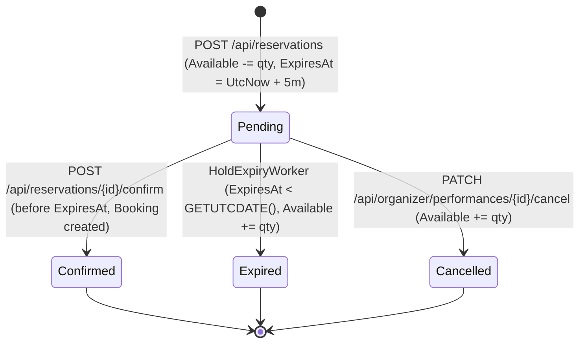

# StagePass Architecture

## 1. System overview

StagePass is a high-concurrency live-event discovery, reservation hold, and ticket booking platform built on ASP.NET Core (.NET 10) and Microsoft SQL Server. In live-event ticketing, the hardest engineering problem occurs during a high-demand on-sale ("flash sale"): thousands of users click "Reserve" at the exact same millisecond for the last remaining tickets. A naive system reads the available ticket count into application memory, checks `if (available >= quantity)` in C#, and then issues a separate `UPDATE` statement; under concurrent load, multiple threads read the same positive count before any thread commits, causing every thread to proceed and oversell the venue. StagePass eliminates overselling by pushing the availability check and decrement into a single atomic, conditional SQL `UPDATE` statement inside an explicit database transaction, backed by SQL Server row-level lock serialization, unique idempotency constraints, and engine-level `CHECK` constraints.

---

## 2. Technology stack

| Layer | Technology | Version | Purpose |
|---|---|---|---|
| Runtime & SDK | .NET SDK / Runtime | `10.0` (`net10.0`, C# 13) | Cross-platform application runtime and compiler |
| Web Framework | ASP.NET Core Web API | `10.0` | REST API routing, middleware pipeline, rate limiting, and static file hosting |
| ORM & Data Access | `Microsoft.EntityFrameworkCore.SqlServer` | `10.0.14` | Database schema mapping, migrations, LINQ projections, and raw parameterized SQL execution |
| Migration Tooling | `Microsoft.EntityFrameworkCore.Design` / `dotnet-ef` | `10.0.14` | Design-time schema migration generation and database updates |
| Database Engine | Microsoft SQL Server | `2022` / `2025` / `LocalDB` | ACID transactional storage, row-level `U`/`X` locking, `OUTPUT` clause, and `CHECK` constraints |
| Cryptography | `System.Security.Cryptography` (BCL) + `.Pkcs` | `10.0.14` | PBKDF2-SHA256 password hashing (`Rfc2898DeriveBytes`), CSPRNG salt generation, and constant-time comparison |
| Background Processing | `BackgroundService` + `PeriodicTimer` | `10.0` (BCL) | In-process periodic expiration of stale reservation holds and batch inventory restoration |
| Frontend UI | Vanilla HTML5, CSS3, ECMAScript 2022 | Standards-based | Zero-dependency 7-page web application served via `UseDefaultFiles()` and `UseStaticFiles()` |
| Test Framework | xUnit + `Microsoft.AspNetCore.Mvc.Testing` | `2.9.3` / `10.0.14` | In-memory test host (`WebApplicationFactory<Program>`) executing against isolated `StagePassTestDb` |
| Code Coverage | `coverlet.collector` | `6.0.4` | Test coverage collection during automated test runs |

---

## 3. Solution structure

```text
StagePass/
├── StagePass.slnx                          # XML solution file binding StagePass.Api and StagePass.Tests
├── .config/dotnet-tools.json               # Local CLI tool manifest pinning dotnet-ef 10.0.14
├── README.md                               # Reproducible setup, configuration, and test execution guide
├── SETUP.md                                # Detailed environment onboarding and troubleshooting guide
├── ARCHITECTURE.md                         # Complete technical architecture and invariant reference
├── MANAGER_DEMO.md                         # 12-minute live presentation script and panel Q&A guide
├── CLAUDE_HANDOFF.md                       # Code review handoff and security verification record
├── StagePass.Api/                          # ASP.NET Core Web API host + static frontend
│   ├── Program.cs                          # DI registration, middleware pipeline, rate limiter, dev seeding
│   ├── appsettings.json                    # Base production-safe defaults (RateLimiting:BookingEnabled = true)
│   ├── appsettings.Development.json        # Development overrides (RateLimiting:BookingEnabled = "false")
│   ├── appsettings.Testing.json            # Automated test overrides (RateLimiting:BookingEnabled = false)
│   ├── BackgroundServices/                 # Hosted background workers (HoldExpiryWorker)
│   ├── Controllers/                        # REST API controllers (Auth, Performances, Reservations, Bookings, Organizer, Demo)
│   ├── Data/                               # StagePassDbContext, DbInitializer, and EF Core Migrations
│   ├── DTOs/                               # Request/response data transfer objects and validation attributes
│   │   ├── Auth/                           # RegisterRequest, LoginRequest, AuthResponse
│   │   ├── Bookings/                       # BookingDetailsDto
│   │   ├── Organizers/                     # CreateEventRequest, CreatePerformanceRequest, CreateTicketTypeRequest, OrganizerBookingDto
│   │   ├── Performances/                   # PerformanceListItemDto, PerformanceDetailsDto, TicketTypeDto
│   │   └── Reservations/                   # CreateReservationRequest, ConfirmReservationRequest, ReservationResponse
│   ├── Entities/                           # EF Core domain entities (9 tables including AppUser and AppSession)
│   ├── Enums/                              # PerformanceStatus (Upcoming, Cancelled), ReservationStatus (Pending, Confirmed, Expired, Cancelled)
│   ├── Security/                           # PasswordHasher, SessionAuthMiddleware, RequireAuthAttribute, RequireOrganizerAttribute
│   ├── Services/                           # Transactional domain services (InventoryService, ReservationService, BookingService, EmailService)
│   └── wwwroot/                            # Static frontend (7 HTML pages, css/site.css, 9 modular JS files)
└── StagePass.Tests/                        # Automated unit, integration, security, and concurrency test suite (88 tests)
    ├── TestWebApplicationFactory.cs        # Custom WebApplicationFactory pinned to StagePassTestDb
    ├── UnitTests/                          # Input validation and seed idempotency tests
    └── IntegrationTests/                   # Lifecycle, idempotency, 500-request concurrency, smoke, auth, and security tests
```

- **`StagePass.Api/BackgroundServices/`**: Contains `HoldExpiryWorker`, a singleton `BackgroundService` that ticks every `HoldExpiry:IntervalSeconds` (default 60s) to expire pending holds past `ExpiresAt` and restore their quantities to `TicketTypes.Available`.
- **`StagePass.Api/Controllers/`**: Thin HTTP adapters that validate inputs, invoke domain services or EF Core projections, and translate `ServiceResult<T>` error codes into HTTP status codes (`200`, `201`, `400`, `401`, `403`, `404`, `409`).
- **`StagePass.Api/Data/`**: Houses `StagePassDbContext` (fluent schema mappings, unique indexes, check constraints, cascade rules), `DbInitializer` (idempotent development seeding), and the migration history (`InitialCreate` and `AddAuthentication`).
- **`StagePass.Api/DTOs/`**: Strongly typed request/response contracts using DataAnnotations and `IValidatableObject` (such as rejecting `Guid.Empty` on `CreateReservationRequest.IdempotencyKey`).
- **`StagePass.Api/Entities/`**: Nine persistence models mapping 1:1 to SQL Server tables (`Venues`, `Organizers`, `Events`, `Performances`, `TicketTypes`, `ReservationHolds`, `Bookings`, `AppUsers`, `AppSessions`).
- **`StagePass.Api/Security/`**: Zero-dependency PBKDF2-SHA256 password hashing, per-request Bearer session resolution middleware, and authorization filters (`[RequireAuth]`, `[RequireOrganizer]`).
- **`StagePass.Api/Services/`**: Core transactional business logic (`InventoryService`, `ReservationService`, `BookingService`) plus `ServiceResult<T>` and `ErrorCodes`.
- **`StagePass.Api/wwwroot/`**: Static HTML/CSS/JS frontend served directly by Kestrel without a bundler or Node build pipeline.
- **`StagePass.Tests/`**: 88 xUnit tests covering validation, lifecycle transitions, idempotency races, 500-thread SQL Server concurrency, authentication, confirmation email triggers, and environment gating.

---

## 4. The inventory invariant

Every ticket tier (`TicketTypes` row) satisfies a strict conservation invariant at all times—before, during, and after any combination of concurrent requests, confirmations, expirations, or cancellations:

```text
Available = Capacity − Σ(Quantity WHERE Status ∈ {'Pending', 'Confirmed'})
```

Equivalently:

```text
Available + PendingHeld + Confirmed = Capacity
```

### State transitions and invariant preservation

1. **Hold creation (`[New] → Pending`)**:
   - `TicketTypes.Available` is atomically decremented by `Quantity` (`Available = Available - @qty`).
   - A `ReservationHolds` row is inserted in the same transaction with `Status = 'Pending'` and `Quantity = @qty`.
   - `Available` decreases by `Quantity` while `PendingHeld` increases by `Quantity`; the sum remains `Capacity`.
2. **Hold confirmation (`Pending → Confirmed`)**:
   - The `ReservationHolds` row transitions from `Status = 'Pending'` to `Status = 'Confirmed'`, and a `Bookings` row is inserted in the same transaction.
   - `TicketTypes.Available` is **not** modified because the inventory was already deducted when the hold was placed.
   - `PendingHeld` decreases by `Quantity` while `Confirmed` increases by `Quantity`; the sum remains `Capacity`.
3. **Hold expiry (`Pending → Expired`)**:
   - `HoldExpiryWorker` transitions expired holds from `Status = 'Pending'` to `Status = 'Expired'` and captures `(TicketTypeId, Quantity)` via SQL Server's `OUTPUT` clause.
   - In the same transaction, `TicketTypes.Available` is incremented by the aggregated `SUM(Quantity)` per `TicketTypeId`.
   - `PendingHeld` decreases by `SUM(Quantity)` while `Available` increases by `SUM(Quantity)`; the sum remains `Capacity`.
4. **Performance cancellation (`Pending → Cancelled`)**:
   - `ReservationService.CancelPerformanceAsync` sets `Performances.Status = 'Cancelled'`, transitions all `Pending` holds for that performance to `Status = 'Cancelled'` via `OUTPUT`, and increments `TicketTypes.Available` by the aggregated `SUM(Quantity)` per `TicketTypeId`.
   - Any already-`Confirmed` bookings remain `Confirmed` for auditing/refund workflows, while all `Pending` holds return to `Available`; the sum remains `Capacity`.

### Database-level `CHECK` constraints

Even if a bug were introduced in application code, SQL Server enforces range integrity on every write to `TicketTypes` and `ReservationHolds`:

- `CK_TicketTypes_Capacity`: `Capacity > 0`
- `CK_TicketTypes_Available`: `Available >= 0 AND Available <= Capacity`
- `CK_TicketTypes_Price`: `Price >= 0`
- `CK_ReservationHolds_Quantity`: `Quantity >= 1 AND Quantity <= 10`

Any `UPDATE` that would drive `Available` below `0` or above `Capacity` is immediately aborted by the SQL Server storage engine.

---

## 5. The atomic allocation mechanism

`InventoryService.TryAllocateAsync` executes the following parameterized SQL statement inside an explicit EF Core database transaction (`await _context.Database.BeginTransactionAsync(ct)`):

```sql
UPDATE TicketTypes
SET Available = Available - @qty
WHERE TicketTypeId = @id
  AND Available >= @qty
  AND PerformanceId IN (
      SELECT PerformanceId FROM Performances WHERE Status = 'Upcoming'
  )
```

### Why `rows_affected == 0` guarantees race-free rejection

1. **Single-statement predicate evaluation and mutation**:
   Instead of reading `Available` into C# and issuing a second `UPDATE`, the availability check (`Available >= @qty`), the parent performance state check (`Status = 'Upcoming'`), and the decrement (`SET Available = Available - @qty`) are fused into a single `UPDATE` statement.
2. **Row-level lock serialization under `READ COMMITTED`**:
   Under SQL Server's default `READ COMMITTED` isolation level, when executing an `UPDATE`, the database engine acquires an Update (`U`) lock on the `TicketTypes` row while evaluating the `WHERE` predicate and converts it to an Exclusive (`X`) lock before modifying the row. The `X` lock is held until the enclosing transaction commits or rolls back.
   - If 500 concurrent transactions execute this `UPDATE` against a `TicketType` with `Available = 100` and `@qty = 1`, SQL Server serializes access to that row one transaction at a time.
   - The first 100 transactions see `Available >= 1`, decrement `Available` from `100` down to `0`, insert their `ReservationHold` rows, and commit (`rowsAffected == 1`).
   - Transaction #101 acquires the lock after #100 commits, evaluates `WHERE Available >= 1` against the committed value `0`, matches zero rows, and returns `rowsAffected == 0` without mutating any state.
3. **Why the naive read-check-update alternative fails**:
   In the naive pattern (`SELECT Available FROM TicketTypes WHERE TicketTypeId = @id` → `if (available >= qty)` → `UPDATE TicketTypes SET Available = Available - @qty`), `READ COMMITTED` releases shared (`S`) read locks as soon as the `SELECT` completes. Ten concurrent requests can all read `Available = 1` simultaneously, all pass the C# `if` check, and all execute the unconditional decrement—resulting in 10 holds sold for 1 ticket.

When `rowsAffected == 0`, `InventoryService` rolls back the transaction and inspects `TicketTypes` (with `Include(tt => tt.Performance)`) using `AsNoTracking()` to return a precise domain error code:
- `ErrorCodes.TicketTypeNotFound` (`409 Conflict`) if the ticket type ID does not exist.
- `ErrorCodes.PerformanceCancelled` (`409 Conflict`) if the parent performance status is not `Upcoming`.
- `ErrorCodes.InsufficientInventory` (`409 Conflict`) if the performance is upcoming but `Available < Quantity`.

---

## 6. The idempotency mechanism

Every `POST /api/reservations` request requires a client-generated `IdempotencyKey` (`Guid`, validated to reject `Guid.Empty`). The `ReservationHolds` table enforces a database-level unique index on this column:

```sql
CREATE UNIQUE INDEX IX_ReservationHolds_IdempotencyKey
ON ReservationHolds (IdempotencyKey);
```

### Three execution paths through `InventoryService.TryAllocateAsync`

```text
                       POST /api/reservations
                                 │
                   ┌─────────────┴─────────────┐
                   │ Pre-check: SELECT Hold    │
                   │ WHERE IdempotencyKey = @k │
                   └─────────────┬─────────────┘
                                 │
          ┌──────────────────────┼──────────────────────┐
          ▼                      ▼                      ▼
   [1. Found & Match]   [2. Found & Mismatch]    [3. Not Found]
   Same TicketTypeId,   Different TicketTypeId,  Begin Transaction
   Quantity, Customer   Quantity, or Customer    Atomic SQL UPDATE
          │                      │                      │
          ▼                      ▼                      ▼
     Return 200 OK         Return 409 Conflict   INSERT ReservationHold
    (Existing Hold)      (IdempotencyKeyReused)         │
                                           ┌────────────┴────────────┐
                                           ▼                         ▼
                                    [Commit Succeeds]     [DbUpdateException 2601/2627]
                                           │              Rollback Transaction
                                           ▼              Re-query Hold by Key
                                   Return 201 Created                │
                                    (NewlyCreated)                   ▼
                                                            Return 200 OK or 409
```

1. **Path 1 — Pre-check finds existing hold with matching parameters (`200 OK`)**:
   If a client retries due to a network timeout after the first request already succeeded, the pre-check finds the existing `ReservationHold` with the same `TicketTypeId`, `Quantity`, and `CustomerIdentifier`. It returns the existing `ReservationResponse` with `NewlyCreated = false` (`200 OK`) without touching `TicketTypes.Available`.
2. **Path 2 — Pre-check finds existing hold with different parameters (`409 IdempotencyKeyReused`)**:
   If the caller reuses an `IdempotencyKey` with a different `TicketTypeId`, `Quantity`, or `CustomerIdentifier`, `MatchesRequest` returns `false` and the service immediately returns `409 Conflict` (`{ error: "IdempotencyKeyReused" }`).
3. **Path 3 — Pre-check finds nothing (New allocation or concurrent same-key race)**:
   - The service opens a transaction, executes the atomic `UPDATE TicketTypes`, inserts the `ReservationHold`, and commits (`201 Created`).
   - **Concurrent race handling**: If 50 concurrent requests arrive at the exact same millisecond carrying the **same** `IdempotencyKey`, multiple threads can pass the pre-check before any thread commits. All of them enter the transaction block, and more than one may even succeed at the `UPDATE TicketTypes` step if enough inventory exists. However, when they execute `INSERT INTO ReservationHolds` and `SaveChangesAsync`, SQL Server's `IX_ReservationHolds_IdempotencyKey` unique index allows **only one** transaction to commit.
   - Every losing thread catches `DbUpdateException` (`SqlException` error numbers `2601` or `2627`), calls `await transaction.RollbackAsync()` (which automatically rolls back its `UPDATE TicketTypes` decrement!), clears the `ChangeTracker`, re-queries the winning `ReservationHold` by `IdempotencyKey`, verifies parameter equality, and returns `200 OK` with the winning hold.

---

## 7. The reservation hold lifecycle (state machine)



```text
[New Hold]
  Pending ──(confirm, before ExpiresAt)──→ Confirmed ──→ [Booking created]
  Pending ──(ExpiresAt passes, worker runs)──→ Expired
  Pending ──(performance cancelled)──→ Cancelled
```

### Transition rules and concurrency guards

- **`Pending → Confirmed` (`ReservationService.ConfirmHoldAsync`)**:
  Runs inside a transaction. Verifies the hold exists (`404` otherwise), checks `Status`:
  - `Confirmed` → `409 AlreadyConfirmed`
  - `Expired` → `409 HoldExpired`
  - `Cancelled` → `409 PerformanceCancelled`
  - `ExpiresAt <= DateTime.UtcNow` → `409 HoldExpired`
  - `CustomerIdentifier != request.CustomerIdentifier` (ordinal) → `409 InvalidOwner`
  To guard against a split-second race where `HoldExpiryWorker` or `CancelPerformanceAsync` modifies the hold between the `SELECT` and `SaveChangesAsync`, the confirmation transition itself is executed as a conditional atomic `UPDATE`:
  ```sql
  UPDATE ReservationHolds
  SET Status = 'Confirmed'
  WHERE HoldId = @holdId
    AND Status = 'Pending'
    AND ExpiresAt > GETUTCDATE()
  ```
  If `rowsAffected == 0`, the transaction rolls back and re-reads the hold to report the exact reason (`HoldExpired`, `PerformanceCancelled`, or `AlreadyConfirmed`). Otherwise, it generates a unique `SP-XXXXXXXX` booking reference (`Guid.NewGuid().ToString("N")[..8].ToUpperInvariant()`), inserts the `Booking` row, and commits.

---

## 8. Authentication system

StagePass implements a self-contained, database-backed session authentication system in `StagePass.Api/Security/` without external NuGet packages or JWT complexity. This design provides immediate server-side session revocation on logout, zero external library dependencies, and straightforward inspection in SQL Server.

### Authentication entities

| Entity / Table | Column | SQL Type | Constraints & Purpose |
|---|---|---|---|
| `AppUser` (`AppUsers`) | `UserId` | `int IDENTITY(1,1)` | Primary key |
| `AppUser` (`AppUsers`) | `Email` | `nvarchar(256)` | Normalized (`Trim().ToLowerInvariant()`), `UNIQUE` index `IX_AppUsers_Email` |
| `AppUser` (`AppUsers`) | `Name` | `nvarchar(200)` | Display name |
| `AppUser` (`AppUsers`) | `PasswordHash` | `nvarchar(128)` | Base64 PBKDF2-SHA256 32-byte key (100,000 iterations) |
| `AppUser` (`AppUsers`) | `PasswordSalt` | `nvarchar(64)` | Base64 CSPRNG 32-byte salt (`RandomNumberGenerator.GetBytes(32)`) |
| `AppUser` (`AppUsers`) | `IsOrganizer` | `bit` | Role flag (`true` for event organizers, `false` for customers) |
| `AppUser` (`AppUsers`) | `CreatedAt` | `datetime2` | Default `GETUTCDATE()` |
| `AppSession` (`AppSessions`) | `SessionId` | `int IDENTITY(1,1)` | Primary key |
| `AppSession` (`AppSessions`) | `Token` | `nvarchar(64)` | Opaque GUID string (`Guid.NewGuid().ToString()`), `UNIQUE` index `IX_AppSessions_Token` |
| `AppSession` (`AppSessions`) | `UserId` | `int` | Foreign key to `AppUsers(UserId)` (`ON DELETE CASCADE`) |
| `AppSession` (`AppSessions`) | `CreatedAt` | `datetime2` | Default `GETUTCDATE()` |
| `AppSession` (`AppSessions`) | `ExpiresAt` | `datetime2` | `UtcNow.AddDays(SessionDurationDays)` (default 7 days) |

### Password hashing (`PasswordHasher.cs`)

Passwords are never stored or logged in plaintext:
- **Hashing**: Generates a 32-byte salt via `RandomNumberGenerator.GetBytes(32)` and derives a 32-byte subkey using `Rfc2898DeriveBytes.Pbkdf2(password, salt, 100_000, HashAlgorithmName.SHA256, 32)`.
- **Verification**: Recomputes the PBKDF2-SHA256 digest with the stored salt and compares the byte arrays using `CryptographicOperations.FixedTimeEquals(actualHash, expectedHash)` to prevent timing side-channel attacks.

### Middleware pipeline position

In `Program.cs`, `SessionAuthMiddleware` is registered between routing and rate limiting/authorization:

```text
UseHttpsRedirection → UseDefaultFiles → UseStaticFiles → UseRouting
  → UseMiddleware<SessionAuthMiddleware> → UseRateLimiter → UseAuthorization → MapControllers
```

On every request, `SessionAuthMiddleware` inspects the `Authorization` header for a `Bearer <token>` prefix. If present and non-empty, it queries `AppSessions` (`Include(s => s.User).AsNoTracking()`) for a matching `Token` with `ExpiresAt > DateTime.UtcNow`. When found, it populates `context.Items["CurrentUser"] = session.User` and `context.Items["SessionToken"] = token`. Invalid or expired tokens are ignored by the middleware so public endpoints remain accessible even if a browser sends a stale token.

### Authorization filter chain

- **`[RequireAuth]` (`RequireAuthAttribute : ActionFilterAttribute`)**: Checks `context.HttpContext.Items["CurrentUser"] is AppUser`. If missing, short-circuits the request with `401 Unauthorized` (`{ error = "AuthRequired", message = "Please log in to continue." }`).
- **`[RequireOrganizer]` (`RequireOrganizerAttribute : ActionFilterAttribute`)**: Enforces the `[RequireAuth]` check first (`401 AuthRequired` if unauthenticated), then verifies `user.IsOrganizer == true`. If `false`, short-circuits with `403 Forbidden` (`{ error = "OrganizerRequired", message = "This action requires an organizer account." }`).

### Seeded demo organizer and `Organizers` table linkage

`DbInitializer.SeedAsync` seeds a demo organizer user (`admin@stagepass.local` / `StagePass2026!`, `IsOrganizer = true`) and ensures the seeded `Organizers` table record has `Email = "admin@stagepass.local"`. In this MVP, `AppUser` is linked to the domain `Organizers` table by matching email: when a user registers with `IsOrganizer = true` or creates their first event in `OrganizerController`, StagePass links or auto-provisions their corresponding `Organizers` domain record so self-registered organizers can create and manage events immediately.

---

## 9. The hold expiry background worker

`HoldExpiryWorker` (`StagePass.Api/BackgroundServices/HoldExpiryWorker.cs`) is a `BackgroundService` that runs on a `PeriodicTimer` (configured via `HoldExpiry:IntervalSeconds`, default `60` seconds) to reclaim inventory from unconfirmed holds whose 5-minute window has elapsed.

### The three-step transactional batch pattern

Inside `ExpireHoldsAsync`, the worker creates a DI scope, starts a database transaction, and executes a single batch SQL batch:

```sql
DECLARE @Expired TABLE (TicketTypeId int NOT NULL, Quantity int NOT NULL);

-- Step 1: Atomically transition expired Pending holds and capture their quantities
UPDATE ReservationHolds
SET Status = 'Expired'
OUTPUT DELETED.TicketTypeId, DELETED.Quantity INTO @Expired
WHERE Status = 'Pending' AND ExpiresAt < GETUTCDATE();

-- Step 2 & 3: Aggregate by TicketTypeId and restore Available in one set-based UPDATE
UPDATE tt
SET tt.Available = tt.Available + agg.TotalQuantity
FROM TicketTypes tt
INNER JOIN (
    SELECT TicketTypeId, SUM(Quantity) AS TotalQuantity
    FROM @Expired
    GROUP BY TicketTypeId
) agg ON tt.TicketTypeId = agg.TicketTypeId;

SELECT COALESCE(SUM(Quantity), 0) AS Value FROM @Expired;
```

### Why `GROUP BY TicketTypeId, SUM(Quantity)` before `UPDATE TicketTypes` is mandatory

In SQL Server, an `UPDATE ... FROM` statement that joins a target table (`TicketTypes`) directly to an unaggregated source table (`@Expired`) where multiple source rows match the same target `TicketTypeId` is **non-deterministic**: SQL Server silently picks **one** arbitrary source row per target row and ignores the rest! For example, if three holds of quantities `2`, `3`, and `1` for `TicketTypeId = 5` expire in the same batch, an unaggregated join would increment `Available` by only `2` (or `3`, or `1`) instead of `6`, permanently leaking inventory and violating the conservation invariant. Grouping `@Expired` by `TicketTypeId` and computing `SUM(Quantity)` guarantees each `TicketTypeId` appears at most once in the join and restores the exact total quantity.

### `IServiceScopeFactory` lifecycle management

Because `HoldExpiryWorker` is registered as a singleton (`AddSingleton<HoldExpiryWorker>()` / `AddHostedService<HoldExpiryWorker>()`), it cannot inject `StagePassDbContext` (which is `Scoped`) directly into its constructor. Instead, it injects `IServiceScopeFactory` and creates a fresh `AsyncServiceScope` on each timer tick, ensuring the `DbContext` and its connection are cleanly disposed after every batch.

---

## 10. Database schema

### Entity-Relationship Diagram (9 tables)

```mermaid
erDiagram
    Organizers ||--o{ Events : "owns (Restrict)"
    Venues ||--o{ Events : "hosts (Restrict)"
    Events ||--o{ Performances : "schedules (Cascade)"
    Performances ||--o{ TicketTypes : "offers (Cascade)"
    TicketTypes ||--o{ ReservationHolds : "allocates (Restrict)"
    ReservationHolds ||--o| Bookings : "confirms (Restrict)"
    AppUsers ||--o{ AppSessions : "authenticates (Cascade)"

    Venues {
        int VenueId PK
        nvarchar_200 Name
        nvarchar_300 Address
        nvarchar_100 City
        datetime2 CreatedAt
    }
    Organizers {
        int OrganizerId PK
        nvarchar_200 Name
        nvarchar_200 Email
        datetime2 CreatedAt
    }
    Events {
        int EventId PK
        int OrganizerId FK
        int VenueId FK
        nvarchar_200 Title
        nvarchar_100 Category
        nvarchar_max Description
        datetime2 CreatedAt
    }
    Performances {
        int PerformanceId PK
        int EventId FK
        datetime2 StartDateTime
        nvarchar_20 Status "Upcoming | Cancelled"
        datetime2 CreatedAt
    }
    TicketTypes {
        int TicketTypeId PK
        int PerformanceId FK
        nvarchar_100 Name
        decimal_10_2 Price
        int Capacity
        int Available
    }
    ReservationHolds {
        int HoldId PK
        int TicketTypeId FK
        int Quantity
        uniqueidentifier IdempotencyKey UK
        nvarchar_200 CustomerIdentifier
        datetime2 ExpiresAt
        nvarchar_20 Status "Pending | Confirmed | Expired | Cancelled"
        datetime2 CreatedAt
    }
    Bookings {
        int BookingId PK
        int HoldId FK_UK
        nvarchar_50 BookingReference UK
        nvarchar_200 CustomerIdentifier
        decimal_10_2 TotalAmount
        nvarchar_20 Status "Confirmed"
        datetime2 CreatedAt
    }
    AppUsers {
        int UserId PK
        nvarchar_256 Email UK
        nvarchar_200 Name
        nvarchar_128 PasswordHash
        nvarchar_64 PasswordSalt
        bit IsOrganizer
        datetime2 CreatedAt
    }
    AppSessions {
        int SessionId PK
        nvarchar_64 Token UK
        int UserId FK
        datetime2 CreatedAt
        datetime2 ExpiresAt
    }
```

### Constraints and indexes inventory

| Table | Name | Type | Definition / Columns |
|---|---|---|---|
| `TicketTypes` | `CK_TicketTypes_Capacity` | `CHECK` | `[Capacity] > 0` |
| `TicketTypes` | `CK_TicketTypes_Available` | `CHECK` | `[Available] >= 0 AND [Available] <= [Capacity]` |
| `TicketTypes` | `CK_TicketTypes_Price` | `CHECK` | `[Price] >= 0` |
| `TicketTypes` | `IX_TicketTypes_PerformanceId_Name` | `UNIQUE INDEX` | `(PerformanceId, Name)` |
| `ReservationHolds` | `CK_ReservationHolds_Quantity` | `CHECK` | `[Quantity] >= 1 AND [Quantity] <= 10` |
| `ReservationHolds` | `IX_ReservationHolds_IdempotencyKey` | `UNIQUE INDEX` | `(IdempotencyKey)` |
| `ReservationHolds` | `IX_ReservationHolds_Status_ExpiresAt` | `INDEX` | `(Status, ExpiresAt)` (optimizes `HoldExpiryWorker` scan) |
| `Bookings` | `IX_Bookings_BookingReference` | `UNIQUE INDEX` | `(BookingReference)` |
| `Bookings` | `IX_Bookings_HoldId` | `UNIQUE INDEX` | `(HoldId)` (1:1 relationship with `ReservationHolds`) |
| `AppUsers` | `IX_AppUsers_Email` | `UNIQUE INDEX` | `(Email)` |
| `AppSessions` | `IX_AppSessions_Token` | `UNIQUE INDEX` | `(Token)` |

---

## 11. API contracts

| Method | Route | Auth / Policy | Request Body / Query | Response Body | Status Codes |
|---|---|---|---|---|---|
| `POST` | `/api/auth/register` | Public | `{ email, password, name, isOrganizer }` | `AuthResponse { token, userId, name, email, isOrganizer, expiresAt }` | `200`, `400`, `409 EmailAlreadyRegistered` |
| `POST` | `/api/auth/login` | Public | `{ email, password }` | `AuthResponse { token, userId, name, email, isOrganizer, expiresAt }` | `200`, `400`, `401 InvalidCredentials` |
| `POST` | `/api/auth/logout` | `[RequireAuth]` | None (`Authorization: Bearer <token>`) | `{ message: "Logged out." }` | `200`, `401 AuthRequired` |
| `GET` | `/api/auth/me` | `[RequireAuth]` | None (`Authorization: Bearer <token>`) | `{ userId, name, email, isOrganizer }` | `200`, `401 AuthRequired` |
| `GET` | `/api/performances` | Public | Query: `category?`, `date?`, `search?`, `page=1`, `pageSize=10` | `List<PerformanceListItemDto>` | `200`, `400 InvalidDate` |
| `GET` | `/api/performances/{id:int}` | Public | Route: `id` | `PerformanceDetailsDto` (with `TicketTypes`) | `200`, `404` |
| `POST` | `/api/reservations` | Public + RateLimit `booking` | `{ ticketTypeId, quantity, idempotencyKey, customerIdentifier }` | `ReservationResponse { holdId, expiresAt, status, ticketTypeName, quantity }` | `201`, `200` (idempotent retry), `400`, `409`, `429` |
| `GET` | `/api/reservations/{holdId:int}` | Public | Route: `holdId` | `ReservationResponse` | `200`, `404` |
| `POST` | `/api/reservations/{holdId:int}/confirm` | Public | `{ customerIdentifier }` | `{ bookingReference: "SP-XXXXXXXX" }` | `200`, `400`, `404`, `409` (`HoldExpired`, `AlreadyConfirmed`, `InvalidOwner`, `PerformanceCancelled`) |
| `GET` | `/api/bookings/{reference}` | Public | Route: `reference` | `BookingDetailsDto` | `200`, `404` |
| `GET` | `/api/organizer/venues` | `[RequireOrganizer]` | None | `List<{ venueId, name, city }>` | `200`, `401`, `403` |
| `POST` | `/api/organizer/events` | `[RequireOrganizer]` | `{ title, category, description, venueId, organizerId }` | `{ eventId }` | `201`, `400 VenueNotFound`, `401`, `403` |
| `POST` | `/api/organizer/performances` | `[RequireOrganizer]` | `{ eventId, startDateTime }` | `{ performanceId }` | `201`, `400 StartDateTimeMustBeInFuture`, `401`, `403`, `404 EventNotFound` |
| `POST` | `/api/organizer/performances/{id:int}/tickettypes` | `[RequireOrganizer]` | `{ name, price, capacity }` | `{ ticketTypeId }` | `201`, `400`, `401`, `403`, `404`, `409 TicketTypeNameAlreadyExists` |
| `GET` | `/api/organizer/performances/{id:int}/bookings` | `[RequireOrganizer]` | Route: `id` | `{ bookings: List<OrganizerBookingDto>, summary: List<{ ticketTypeName, capacity, available, sold }> }` | `200`, `401`, `403`, `404` |
| `PATCH` | `/api/organizer/performances/{id:int}/cancel` | `[RequireOrganizer]` | Route: `id` | `{ status: "Cancelled" }` | `200`, `401`, `403`, `404`, `409 PerformanceCancelled` |
| `POST` | `/api/demo/setup-scenario` | Dev-only (`ExcludeControllerConvention`) | Query: `tickets=100` (`1..10000`), `scenarioName` (`1..100` chars) | `{ ticketTypeId, performanceId, capacity, scenarioName }` | `200`, `400`, `404` (outside Development) |
| `GET` | `/api/demo/snapshot/{ticketTypeId:int}` | Dev-only (`ExcludeControllerConvention`) | Route: `ticketTypeId` (`> 0`) | `{ capacity, available, pendingHeld, confirmed, invariantHolds, formula }` | `200`, `400`, `404` |

---

## 12. Frontend architecture

The frontend in `StagePass.Api/wwwroot/` is a zero-dependency multi-page web application styled with a cohesive dark-stage aesthetic (`css/site.css`). There is no bundler, transpiler, or external CDN dependency; all API calls use same-origin relative URLs.

### The 7 application pages

1. **`index.html` (`js/events.js`)**: Event discovery home page with a dynamic category-gradient hero banner, debounced title search (`300ms`), horizontal scroll carousels (*This Week* and *Trending Near You*), and sticky category filter pills (`All Events`, `Music`, `Theatre`, `Comedy`, `Dance`).
2. **`performance.html` (`js/performance.js`)**: Two-column performance detail and reservation page with interactive ticket tier cards, a 44×44px accessible quantity stepper (`1..10`), a 3-step progress bar (`Choose → Reserve → Confirm`), and an SVG circular ring countdown timer (`05:00` down to `00:00`).
3. **`booking.html` (`js/booking.js`)**: Booking confirmation receipt displaying the `SP-XXXXXXXX` reference code with click-to-copy clipboard support and `@media print` rules for clean paper/PDF printing.
4. **`login.html` (inline auth script)**: Split-screen sign-in page with client validation, `POST /api/auth/login` integration, and `?returnTo=` redirect support.
5. **`register.html` (inline auth script)**: Account creation page supporting both customer accounts and organizer registration (`?organizer=true` pre-checks the organizer option and redirects to `dashboard.html`).
6. **`dashboard.html` (`js/organizer.js`)**: Role-gated Organizer Dashboard (`#auth-gate` shown if not logged in as an organizer) with single-page sidebar navigation (*Overview*, *My Events*, *Create*, *Bookings*), live venue dropdown (`GET /api/organizer/venues`), chained ID auto-population across Event → Performance → Ticket Type creation forms, capacity utilization progress bars, and performance cancellation.
7. **`demo.html` (`js/demo.js`)**: Interactive concurrency test harness that provisions an isolated ticket tier via `POST /api/demo/setup-scenario`, fires up to 600 simultaneous `POST /api/reservations` requests from the browser with per-request transport-failure isolation, and verifies the database invariant via `GET /api/demo/snapshot/{ticketTypeId}`.

### Shared module loading order and session persistence

Every HTML page loads shared scripts in a strict deterministic order:

```html
<script src="js/api.js"></script>
<script src="js/auth.js"></script>
<script src="js/toast.js"></script>
<script src="js/nav.js"></script>
<script src="js/<page>.js"></script>
```

- **`api.js` + `auth.js` Bearer token wrapper**: `api.js` defines `window.apiFetch(path, options)` for JSON request/response handling and structured error extraction. `auth.js` manages the `sp_session` object in `localStorage` (automatically clearing expired sessions) and wraps `window.apiFetch` so every outgoing request automatically includes `Authorization: Bearer <token>` when a user is signed in.
- **`sessionStorage` hold recovery (`performance.js`)**: When a customer reserves tickets on `performance.html`, `displayHold` writes `sp_hold` (`holdId`, `expiresAt`, `quantity`, `ticketTypeId`, `ticketTypeName`, `customerEmail`, `idempotencyKey`, `performanceId`) to `sessionStorage`. If the user refreshes the page (`F5`) while the hold is still unexpired, `DOMContentLoaded` restores `currentHold` and `idempotencyKey`, transitions the UI directly to Step 3 (`#phase-hold`), and resumes the SVG countdown ring from `expiresAt`. `sp_hold` is cleared upon booking confirmation, timer expiry, or `409 HoldExpired`.

---

## 13. Concurrency test results

The automated test suite (`StagePass.Tests`) comprises **86 passing tests** executing against a real SQL Server instance (`StagePassTestDb`), including dedicated multi-threaded concurrency and race-condition suites (`ReservationConcurrencyTests` and `IdempotencyTests`):

- **500 concurrent requests for 100 tickets (`Test_ConcurrentRequests_DoNotOversell`)**:
  Fires 500 simultaneous `POST /api/reservations` HTTP requests (`Quantity = 1`, distinct `IdempotencyKey` per request) via `Task.WhenAll` against a ticket tier with `Capacity = 100, Available = 100`.
  - **Result**: Exactly **100** responses return `201 Created`, **400** return `409 Conflict` (`InsufficientInventory`), and **0** return `5xx` server errors.
  - **Database verification**: `TicketTypes.Available == 0`, `COUNT(ReservationHolds WHERE Status = 'Pending') == 100`, and the conservation invariant holds (`0 + 100 + 0 == 100`).
- **50 concurrent requests with the same idempotency key (`Test_ConcurrentSameIdempotencyKey_CreatesOnlyOneHold`)**:
  Fires 50 simultaneous `POST /api/reservations` requests carrying the **exact same** `IdempotencyKey` (`Quantity = 2`) against a tier with `Capacity = 100`.
  - **Result**: Every response returns `201 Created` or `200 OK` with the identical `HoldId`, **exactly 1** `ReservationHold` row exists in SQL Server, and `TicketTypes.Available` is decremented **once** (`Available == 98`).
- **Confirm-vs-expiry and cancel-vs-expiry race tests**:
  Simultaneously races `POST /api/reservations/{id}/confirm` and `PATCH /api/organizer/performances/{id}/cancel` against `HoldExpiryWorker.ExpireHoldsAsync`, proving that the database conservation invariant (`Available + Pending + Confirmed == Capacity`) holds under all interleavings.

---

## 14. Known limitations and production gaps

1. **Competing in-process expiry workers under horizontal scaling**:
   `HoldExpiryWorker` runs inside the ASP.NET Core web process. If multiple application instances are deployed behind a load balancer, all instances will periodically execute `ExpireHoldsAsync`. Because Step 1 uses `UPDATE ReservationHolds SET Status = 'Expired' OUTPUT DELETED.TicketTypeId, DELETED.Quantity INTO @Expired WHERE Status = 'Pending' AND ExpiresAt < GETUTCDATE()`, SQL Server row locking ensures each expired hold is transitioned by **at most one** instance and its quantity is captured in **only that instance's** `@Expired` table variable—so inventory is still restored accurately without double-counting. However, competing instances create unnecessary lock contention on `ReservationHolds` and `TicketTypes`.
   - **Production fix**: Acquire a distributed application lock via SQL Server `sp_getapplock` before running the expiry batch, or move expiration to an external single-leader job scheduler (e.g., Hangfire or Quartz.NET).
2. **Rate limiting keys on `RemoteIpAddress` without forwarded headers**:
   The `"booking"` rate limiter partitions requests by `httpContext.Connection.RemoteIpAddress?.ToString()`. While accurate for direct connections, behind a reverse proxy, ingress controller, or cloud load balancer, `RemoteIpAddress` is the proxy's internal IP—causing all external users to share a single 10-request/60-second bucket.
   - **Production fix**: Configure `ForwardedHeadersOptions` with known proxy networks and call `app.UseForwardedHeaders()` before `app.UseRateLimiter()`.
3. **Shared organizer authorization scope**:
   While `POST /api/organizer/events` binds new events to the authenticated organizer's `Organizers` record by email, `CreatePerformance`, `CreateTicketType`, `GetPerformanceBookings`, and `CancelPerformance` only check `[RequireOrganizer]` without verifying that `performance.Event.OrganizerId` belongs to the caller. Any authenticated organizer can therefore view or cancel another organizer's performance.
   - **Production fix**: Merge `Organizers` into `AppUsers` and enforce per-resource ownership checks (`Event.OrganizerId == currentUser.UserId`) on every organizer write and read action.
4. **No payment gateway or distributed notification pipeline**:
   Confirming a hold transitions the hold to `Confirmed` and creates a `Booking` row without charging a payment method. Transactional confirmation emails are dispatched post-commit via `IEmailService` using Gmail SMTP (disabled by default; enabled via User Secrets). In high-throughput production, email sending would be offloaded to a background message queue (e.g. Azure Service Bus or RabbitMQ) and transactional provider (SendGrid, Postmark, AWS SES) rather than in-process SMTP.
