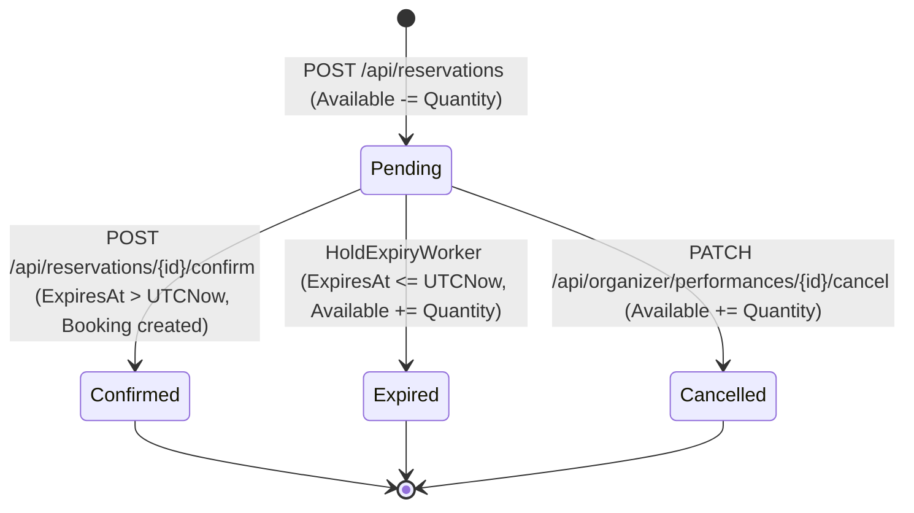

# StagePass Architecture

## 1. Solution Structure

```text
StagePass/
├── StagePass.slnx                          # Solution file
├── .config/dotnet-tools.json               # Local tool manifest (dotnet-ef 10.0.14)
├── README.md                               # Setup, testing, and MVP overview
├── ARCHITECTURE.md                         # Detailed architectural specification
├── StagePass.Api/                          # ASP.NET Core Web API + static frontend
│   ├── BackgroundServices/
│   │   └── HoldExpiryWorker.cs             # Periodic background service expiring stale holds
│   ├── Controllers/
│   │   ├── PerformancesController.cs       # GET /api/performances, GET /api/performances/{id}
│   │   ├── ReservationsController.cs       # POST /api/reservations, GET /{id}, POST /{id}/confirm
│   │   ├── BookingsController.cs           # GET /api/bookings/{reference}
│   │   └── OrganizerController.cs          # POST events/performances/tickettypes, GET bookings, PATCH cancel
│   ├── Data/
│   │   ├── StagePassDbContext.cs           # EF Core DbContext, fluent schema & constraint configuration
│   │   └── DbInitializer.cs                # Idempotent development seed data
│   ├── DTOs/                               # Request/response contracts and validation attributes
│   │   ├── Bookings/BookingDetailsDto.cs
│   │   ├── Organizers/                     # CreateEventRequest, CreatePerformanceRequest, CreateTicketTypeRequest, OrganizerBookingDto
│   │   ├── Performances/                   # PerformanceListItemDto, PerformanceDetailsDto, TicketTypeDto
│   │   └── Reservations/                   # CreateReservationRequest, ConfirmReservationRequest, ReservationResponse
│   ├── Entities/                           # Database entities (Venue, Organizer, Event, Performance, TicketType, ReservationHold, Booking)
│   ├── Enums/                              # PerformanceStatus, ReservationStatus
│   ├── Filters/
│   │   └── OrganizerApiKeyAttribute.cs     # Demo X-Api-Key header filter for organizer endpoints
│   ├── Migrations/                         # EF Core SQL Server schema migrations
│   ├── Services/
│   │   ├── ServiceResult.cs                # Result wrapper + ErrorCodes constants
│   │   ├── InventoryService.cs             # Atomic ticket allocation + idempotency handling
│   │   ├── ReservationService.cs           # Hold lookup, confirmation, and performance cancellation
│   │   └── BookingService.cs               # Confirmed booking lookup by reference
│   ├── wwwroot/                            # Vanilla HTML/CSS/JS frontend (index, performance, booking, organizer)
│   └── Program.cs                          # DI registration, middleware pipeline, dev migration/seed
└── StagePass.Tests/                        # xUnit test project
    ├── TestWebApplicationFactory.cs        # Custom WebApplicationFactory targeting StagePassTestDb
    ├── UnitTests/
    │   ├── ReservationInputTests.cs        # DataAnnotations model validation tests
    │   └── DatabaseSeedVerificationTests.cs# Seed data and idempotency verification
    └── IntegrationTests/
        ├── ReservationLifecycleTests.cs    # End-to-end HTTP hold/confirm/booking/expiry/invariant tests
        ├── IdempotencyTests.cs             # Sequential, conflicting, and 50-concurrent idempotency tests
        ├── ReservationConcurrencyTests.cs  # 500-request oversell test + confirm/cancel vs. expiry races
        └── ApiSmokeTests.cs                # Full HTTP controller contract and status-code tests
```

---

## 2. Request Flow

```text
Browser (wwwroot/*.html + js/*.js)
  │
  │  window.apiFetch(path, options)  [relative URLs, JSON payload]
  ▼
ASP.NET Core Middleware Pipeline (Program.cs)
  │  UseHttpsRedirection → UseDefaultFiles → UseStaticFiles → UseRouting → UseRateLimiter → UseAuthorization
  ▼
API Controllers (Controllers/*Controller.cs)
  │  Model binding & DataAnnotations validation (400 Bad Request on invalid DTOs)
  │  Maps ServiceResult<T> to HTTP status codes (200, 201, 404, 409) and DTOs (never raw entities)
  ▼
Core Domain Services (InventoryService, ReservationService, BookingService)
  │  Manages explicit database transactions and parameterized SQL operations
  ▼
SQL Server (StagePassDb / StagePassTestDb)
     Enforces row-level locks, UNIQUE indexes, FK constraints, and CHECK constraints
```

---

## 3. The Inventory Invariant

For every row in `TicketTypes`, the following invariant must hold after every committed transaction:

$$\text{Available} = \text{Capacity} - \sum \left(\text{Quantity} \;\middle|\; \text{ReservationHold.Status} \in \{\text{'Pending'}, \text{'Confirmed'}\}\right)$$

### How Each Operation Affects the Invariant

| Operation | `TicketType.Available` | `ReservationHold.Status` | Net Effect on Invariant |
| :--- | :--- | :--- | :--- |
| **Create TicketType** | Initialized to `Capacity` | None | `Available (Capacity) = Capacity - 0` |
| **Allocate Hold (`TryAllocateAsync`)** | Decremented by `Quantity` (`Available - Quantity`) | New row inserted with `Status = 'Pending'` | `Available` decreases by $Q$; $\sum \text{Pending}$ increases by $Q$. Sum remains `Capacity`. |
| **Confirm Hold (`ConfirmAsync`)** | Unchanged (`0` delta) | Transitions `'Pending' → 'Confirmed'` | $\sum \text{Pending}$ decreases by $Q$; $\sum \text{Confirmed}$ increases by $Q$. `Available` is untouched because inventory was already deducted at hold creation. |
| **Expire Hold (`ExpireHoldsAsync`)** | Incremented by `Quantity` (`Available + Quantity`) | Transitions `'Pending' → 'Expired'` | $\sum \text{Pending}$ decreases by $Q$; `Available` increases by $Q$. Sum remains `Capacity`. |
| **Cancel Performance (`CancelPerformanceAsync`)** | Incremented by $\sum \text{Pending Quantity}$ | Transitions `'Pending' → 'Cancelled'` | $\sum \text{Pending}$ drops to `0`; `Available` increases by the exact released pending quantity. |

Database-level safety nets in `StagePassDbContext`:
- `CK_TicketType_Available_NonNegative`: `[Available] >= 0`
- `CK_TicketType_Available_Cap`: `[Available] <= [Capacity]`
- `CK_ReservationHold_Quantity`: `[Quantity] BETWEEN 1 AND 10`

---

## 4. The Atomic `UPDATE`

### Exact SQL Statement

Executed in `InventoryService.TryAllocateWithOutcomeAsync` inside an explicit transaction (`BeginTransactionAsync`):

```sql
UPDATE TicketTypes
SET Available = Available - {0}
WHERE TicketTypeId = {1}
  AND Available >= {0}
  AND PerformanceId IN (
      SELECT PerformanceId FROM Performances WHERE Status = 'Upcoming'
  )
```

### Why Read-Check-Update in C# Is Broken

A naive implementation reads `var tt = await db.TicketTypes.FindAsync(id);`, checks `if (tt.Available >= qty)` in C#, and then calls `tt.Available -= qty; await db.SaveChangesAsync();`. Under default `READ COMMITTED` isolation, 500 concurrent requests all read `Available = 100` before any transaction writes back, and all 500 proceed to insert holds—overselling the event by 400 tickets (or causing lost updates where `Available` is overwritten with `99`).

### Why the Conditional `UPDATE` Is Correct

In SQL Server, an `UPDATE` statement acquires an update (`U`) lock while scanning the target row and escalates it to an exclusive (`X`) row lock before modifying `Available`. Concurrent transactions targeting the same `TicketTypeId` are serialized at the row lock:
1. Each transaction evaluates `Available >= @quantity` against the latest committed/locked value.
2. For 100 available tickets and 500 concurrent requests (`Quantity = 1`), the first 100 transactions decrement `Available` from `100` down to `0` (`rowsAffected = 1`) and insert their `ReservationHold` rows within the same transaction.
3. The remaining 400 transactions see `Available = 0`, fail the `WHERE Available >= 1` predicate (`rowsAffected = 0`), roll back, and return `ErrorCodes.InsufficientInventory` (`409 Conflict`).

---

## 5. The Idempotency Mechanism

Network retries and double-clicks are handled via `IdempotencyKey` (`Guid`):

1. **Fast Pre-Check (Read-Only)**:
   Before opening a transaction, `InventoryService` queries `ReservationHolds.AsNoTracking().FirstOrDefaultAsync(h => h.IdempotencyKey == request.IdempotencyKey)`.
   - If found and `TicketTypeId` + `Quantity` match the request: returns the existing hold (`IsNew = false` → `200 OK`).
   - If found with different parameters: returns `ErrorCodes.IdempotencyKeyReused` (`409 Conflict`).
2. **Database Unique Constraint (`IX_ReservationHolds_IdempotencyKey`)**:
   When 50 concurrent requests with the same `IdempotencyKey` arrive simultaneously, multiple requests may pass the read-only pre-check before any transaction commits.
   - Each passing request decrements `Available` and attempts to `INSERT` into `ReservationHolds`.
   - Exactly **one** transaction succeeds and commits (`201 Created`).
   - The other 49 transactions fail on `SaveChangesAsync` with SQL Server error `2601` / `2627` (unique index violation on `IX_ReservationHolds_IdempotencyKey`).
3. **Constraint Fallback & Rollback**:
   The `catch (DbUpdateException ex) when (IsUniqueConstraintViolation(ex))` block rolls back the transaction (which automatically undoes the `Available = Available - @qty` decrement for those 49 losers), clears the `ChangeTracker`, queries the committed winning `ReservationHold`, verifies parameter match, and returns `200 OK` with that same `HoldId`.
   - Furthermore, if inventory hits `0` right as a concurrent duplicate fails the `UPDATE` (`rows == 0`), `InventoryService` checks whether `IdempotencyKey` was just inserted by a sibling request before reporting `InsufficientInventory`.

---

## 6. Reservation Lifecycle State Machine



All state transitions out of `Pending` are **terminal** and guarded by `WHERE Status = 'Pending'` in atomic SQL `UPDATE` statements:
- **`Pending → Confirmed`**: `UPDATE ReservationHolds SET Status = 'Confirmed' WHERE HoldId = @id AND Status = 'Pending' AND ExpiresAt > GETUTCDATE()`. Does not modify `Available`.
- **`Pending → Expired`**: Triggered by `HoldExpiryWorker` when `ExpiresAt <= GETUTCDATE()`. Restores `Quantity` to `TicketTypes.Available`.
- **`Pending → Cancelled`**: Triggered by `ReservationService.CancelPerformanceAsync`. Restores `Quantity` to `TicketTypes.Available`.

Because every transition requires `WHERE Status = 'Pending'`, a hold can never transition twice (e.g., it cannot both confirm and expire, nor can it expire and be cancelled), guaranteeing that inventory is restored **at most once**.

---

## 7. The Expiry Worker

`HoldExpiryWorker` (`BackgroundService`) runs on a `PeriodicTimer` (default 60 seconds, configured via `HoldExpiry:IntervalSeconds`) and executes `ExpireHoldsAsync` in a single explicit transaction:

1. **Step 1 — Atomic Claim via `UPDATE ... OUTPUT INTO`**:
   ```sql
   DECLARE @Expired TABLE (
       HoldId int NOT NULL,
       TicketTypeId int NOT NULL,
       Quantity int NOT NULL
   );

   UPDATE ReservationHolds
   SET Status = 'Expired'
   OUTPUT inserted.HoldId, inserted.TicketTypeId, inserted.Quantity
   INTO @Expired (HoldId, TicketTypeId, Quantity)
   WHERE Status = 'Pending'
     AND ExpiresAt <= GETUTCDATE();

   SELECT HoldId, TicketTypeId, Quantity FROM @Expired;
   ```
   Using `UPDATE ... OUTPUT` atomically transitions eligible rows and returns the exact set of holds that this transaction transitioned from `'Pending'` to `'Expired'`, assisted by the filtered index `IX_ReservationHolds_ExpiresAt_Pending` (`WHERE [Status] = 'Pending'`).
2. **Step 2 — `GroupBy` Aggregation in Memory**:
   Multiple expired holds often belong to the same `TicketTypeId`. Grouping by `TicketTypeId` and summing `Quantity` (`g.Sum(h => h.Quantity)`) reduces $N$ hold expirations into a single `UPDATE TicketTypes` statement per distinct `TicketTypeId`, minimizing lock round-trips. Ordering by `TicketTypeId` ensures deterministic lock acquisition order and prevents deadlocks.
3. **Step 3 — Inventory Restoration in the Same Transaction**:
   `UPDATE TicketTypes SET Available = Available + @total WHERE TicketTypeId = @ticketTypeId` runs inside the same transaction as Step 1. If the process crashes or rolls back during Step 3, Step 1 (`Status = 'Expired'`) is also rolled back, preserving the inventory invariant.

---

## 8. What Breaks Under Horizontal Scaling

### Competing Expiry Workers
`HoldExpiryWorker` is registered as an in-process `IHostedService` inside `StagePass.Api`. If `StagePass.Api` is scaled horizontally to multiple instances behind a load balancer:
1. If implemented with a naive two-step `SELECT WHERE Status = 'Pending'` followed by `UPDATE`, two worker instances ticking at the same moment would read the same expired holds and both add `Quantity` back to `TicketTypes.Available`, double-restoring inventory and violating `CK_TicketType_Available_Cap`.
2. Even with `UPDATE ... OUTPUT` (which prevents double-claiming the same `ReservationHold` row), multiple in-process workers polling simultaneously create unnecessary lock contention on `ReservationHolds` and `TicketTypes`.

### The Fix for Multi-Instance Deployment
- **Option A (Dedicated Worker + Distributed Application Lock)**: Extract `HoldExpiryWorker` into a standalone worker service or scheduled job, and acquire a SQL Server session/transaction application lock (`EXEC sp_getapplock @Resource = 'StagePass_HoldExpiry', @LockMode = 'Exclusive', @LockOwner = 'Transaction', @LockTimeout = 0`) at the start of `ExpireHoldsAsync` so only one instance executes the expiry batch at any time.
- **Option B (Single-Statement Atomic CTE / `UPDATE ... OUTPUT` with `READPAST`)**: Use `WITH (UPDLOCK, READPAST)` on batch claims so workers skip rows already locked by another instance.

---

## 9. Future Extensibility

To evolve StagePass from an MVP into a production ticketing platform:

1. **Real Payment Processing**:
   - Introduce a `PaymentIntentId` / `PaymentStatus` on `ReservationHold`.
   - `POST /api/reservations` creates a Stripe PaymentIntent alongside the hold.
   - Confirmation (`Pending → Confirmed`) is triggered by a verified Stripe webhook (`payment_intent.succeeded`) using idempotent webhook event tracking, with a grace window on `ExpiresAt` for in-flight payment callbacks.
2. **Authentication & Authorization**:
   - Replace `OrganizerApiKeyAttribute` with OIDC / JWT Bearer authentication (e.g., ASP.NET Core Identity, Entra ID, or Auth0).
   - Enforce resource-based authorization in `OrganizerController` so an authenticated organizer can only create performances or view/cancel bookings for events where `Event.OrganizerId == currentUser.OrganizerId`.
3. **Transactional Notifications (Outbox Pattern)**:
   - Write an `OutboxMessage` row inside the same database transaction when a booking is confirmed or a performance is cancelled.
   - A background publisher relays outbox messages to an email/SMS provider (e.g., SendGrid, Amazon SES) with at-least-once delivery.
