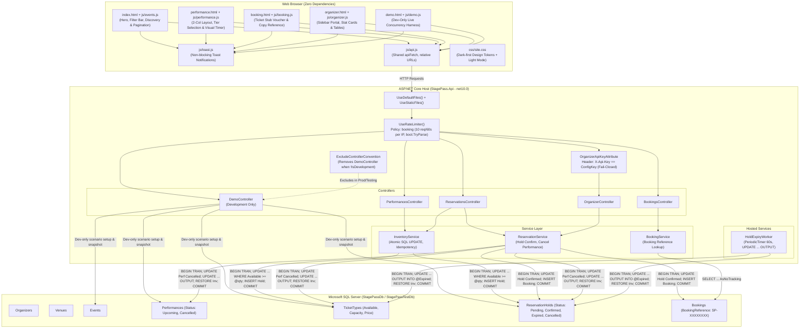

# StagePass: Complete Technical Handoff for Claude Code Review

> **Document Version**: 2.0 (Post UI-3 Security Remediation & Verification)  
> **Target Audience**: Claude (Independent Architecture & Code Reviewer)  
> **Root Directory**: `c:\Users\suhas\Desktop\StagePass`  
> **Target Framework**: .NET 10.0 (`net10.0`), C# 13, ASP.NET Core Web API, EF Core 10.0.14, Microsoft SQL Server 2025  

---

## 1. Document Purpose and Review Orientation

This document is the definitive, self-contained technical handoff for an independent, critical technical review of **StagePass**. It describes the system as implemented in the physical repository files as of October 2026, including the UI-1/UI-2/UI-3 frontend and concurrency demonstration additions and the subsequent UI-3 security remediation.

### How Claude Should Approach This Review
1. **Treat this document as a guide, not ground truth**: Validate every material statement, file path, line reference, class, and method against the source code on disk.
2. **Prioritize the frontend and user experience**: Thoroughly review the vanilla web client in [`StagePass.Api/wwwroot`](file:///c:/Users/suhas/Desktop/StagePass/StagePass.Api/wwwroot), checking semantic structure, styling tokens, toast notifications, error visibility, DOM injection resilience, and state consistency across all 5 HTML pages (`index.html`, `performance.html`, `booking.html`, `organizer.html`, `demo.html`).
3. **Verify concurrency and transactional correctness**: Scrutinize the atomic conditional SQL `UPDATE` in [`InventoryService.cs`](file:///c:/Users/suhas/Desktop/StagePass/StagePass.Api/Services/InventoryService.cs), the idempotency fallback in [`ReservationService.cs`](file:///c:/Users/suhas/Desktop/StagePass/StagePass.Api/Services/ReservationService.cs), the background worker in [`HoldExpiryWorker.cs`](file:///c:/Users/suhas/Desktop/StagePass/StagePass.Api/BackgroundServices/HoldExpiryWorker.cs), and the database constraints in [`StagePassDbContext.cs`](file:///c:/Users/suhas/Desktop/StagePass/StagePass.Api/Data/StagePassDbContext.cs).
4. **Verify UI-3 Demo & Security Controls**: Inspect [`Program.cs`](file:///c:/Users/suhas/Desktop/StagePass/StagePass.Api/Program.cs), [`DemoController.cs`](file:///c:/Users/suhas/Desktop/StagePass/StagePass.Api/Controllers/DemoController.cs), [`OrganizerApiKeyAttribute.cs`](file:///c:/Users/suhas/Desktop/StagePass/StagePass.Api/Filters/OrganizerApiKeyAttribute.cs), and [`DemoAndSecurityTests.cs`](file:///c:/Users/suhas/Desktop/StagePass/StagePass.Tests/IntegrationTests/DemoAndSecurityTests.cs).
5. **Distinguish implementation evidence from dynamic behavior**: Code-derived assertions are labeled based on source inspection. Real runtime behavior verified via the automated test suite (`StagePassTestDb`) is explicitly identified with concrete evidence.
6. **Do not modify files**: Produce an objective, ranked evaluation report first without modifying any application files or database records.

---

## 2. Project Overview and Product Scope

### 2.1 Problem Statement
In high-demand live event ticketing ("flash sales"), thousands of concurrent users attempt to purchase a limited inventory of tickets within seconds. Naive application implementations that read availability into memory, check the balance in C#, and issue a subsequent update suffer from severe race conditions under default `READ COMMITTED` transaction isolation, leading to overselling and negative inventory.

StagePass demonstrates the solution: **pushing the inventory check into an atomic, conditional SQL Server `UPDATE` statement inside an explicit database transaction**, combined with unique index constraints for idempotency and strict database `CHECK` constraints to mathematically guarantee zero overselling.

### 2.2 User Personas and Supported Workflows
- **Ticket Buyer (Customer)**:
  - Discovers upcoming performances with search, category filtering, date selection, and pagination (`index.html`).
  - Views ticket tiers, real-time availability, and pricing (`performance.html`).
  - Holds 1–10 tickets for 5 minutes (`POST /api/reservations`).
  - Observes a visual countdown timer while the server maintains the authoritative hold.
  - Confirms the hold using their email address (`POST /api/reservations/{id}/confirm`).
  - Receives a unique booking reference (`SP-XXXXXXXX`) and views confirmed booking details (`booking.html`).
- **Event Organizer (Demo Persona)**:
  - Connects using a demonstration API key configured via User Secrets (`organizer.html`).
  - Creates new events, future performances, and ticket tiers.
  - Monitors confirmed bookings and capacity/available/sold inventory breakdowns with progress bars.
  - Cancels performances and releases unconfirmed holds back to inventory.
- **Technical Evaluator / Panel Reviewer (Development-Only Live Concurrency Demo)**:
  - Opens `demo.html` (in `Development` environment) to configure a scenario (`1..500` tickets) and fire concurrent reservation requests against `POST /api/reservations`.
  - Observes real-time allocation vs. `409 Conflict` vs. HTTP errors vs. transport failures, and verifies the database invariant (`Available + Pending + Confirmed == Capacity`).

### 2.3 Technology Stack & Versions
- **Runtime / SDK**: .NET 10 SDK (`10.0.403`), targeting `net10.0`.
- **Backend Framework**: ASP.NET Core Web API (Controller-based, minimal `Program.cs`, `System.Text.Json`).
- **ORM & Database Driver**:
  - `Microsoft.EntityFrameworkCore.SqlServer` (`10.0.14`)
  - `Microsoft.EntityFrameworkCore.Design` (`10.0.14`)
  - `Microsoft.Data.SqlClient` (`6.1.7` via EF Core transitive dependency)
  - `System.Security.Cryptography.Pkcs` (`10.0.14` directly referenced to patch transitive advisories)
- **Database Engine**: Microsoft SQL Server 2025 Developer/Evaluation edition on `localhost` (Windows Integrated Security `Trusted_Connection=True`).
- **Frontend**: Zero-dependency Vanilla HTML5, modern CSS3 (custom properties, CSS Grid, Flexbox, media queries), and Vanilla ECMAScript 2022 (Fetch API, DOM manipulation). No Node, no npm, no Vite, no TypeScript, no frameworks, no external CDNs, no external web fonts.
- **Test Framework**: xUnit (`2.9.3`), `Microsoft.NET.Test.Sdk` (`17.14.1`), `Microsoft.AspNetCore.Mvc.Testing` (`10.0.14`), `coverlet.collector` (`6.0.4`).

### 2.4 High-Level System Architecture Diagram



---

## 3. Complete Repository and File Inventory

```text
c:\Users\suhas\Desktop\StagePass\
├── .config/
│   └── dotnet-tools.json                     # Local .NET tool manifest: dotnet-ef 10.0.14
├── .editorconfig                             # Global editor formatting and naming rules
├── .gitignore                                # Build, IDE, and user-secrets artifact exclusions
├── README.md                                 # Reproducible setup, seeding, and run documentation
├── ARCHITECTURE.md                           # Formal architectural specification and invariants
├── MANAGER_DEMO.md                           # Project panel presentation script and talking points
├── CLAUDE_HANDOFF.md                         # This comprehensive technical handoff document
├── StagePass.slnx                            # Solution manifest referencing Api and Tests
├── StagePass.Api/
│   ├── StagePass.Api.csproj                  # Web API project file (net10.0, Nullable, EF Core 10)
│   ├── Program.cs                            # Pipeline setup, DI, ExcludeControllerConvention, rate limiter
│   ├── appsettings.json                      # Base config (OrganizerApiKey: "", BookingEnabled: true)
│   ├── appsettings.Development.json          # Dev config (instructs setting DB & OrganizerApiKey via User Secrets)
│   ├── appsettings.Testing.json              # Test config (rate limiting disabled)
│   ├── StagePass.Api.http                    # VS Code REST Client test requests
│   ├── BackgroundServices/
│   │   └── HoldExpiryWorker.cs               # PeriodicTimer hosted service for hold expiration
│   ├── Controllers/
│   │   ├── PerformancesController.cs         # GET list (supports search/category/date) & GET detail
│   │   ├── ReservationsController.cs         # POST hold, GET hold, POST confirm
│   │   ├── BookingsController.cs             # GET booking by reference
│   │   ├── OrganizerController.cs            # POST event/perf/tier, GET bookings, PATCH cancel
│   │   └── DemoController.cs                 # Dev-only POST setup-scenario & GET snapshot/{ticketTypeId}
│   ├── Data/
│   │   ├── StagePassDbContext.cs             # EF Core DbContext, constraints, fluent mapping
│   │   ├── DbInitializer.cs                  # Idempotent dev seeder (2 venues, 1 org, 2 events, 3 perfs, 6 tiers)
│   │   └── Migrations/
│   │       ├── 20261027104645_InitialCreate.cs
│   │       ├── 20261027104645_InitialCreate.Designer.cs
│   │       └── StagePassDbContextModelSnapshot.cs
│   ├── DTOs/
│   │   ├── Bookings/BookingDetailsDto.cs
│   │   ├── Organizers/
│   │   │   ├── CreateEventRequest.cs
│   │   │   ├── CreatePerformanceRequest.cs
│   │   │   ├── CreateTicketTypeRequest.cs
│   │   │   └── OrganizerBookingDto.cs
│   │   ├── Performances/
│   │   │   ├── PerformanceListItemDto.cs
│   │   │   ├── PerformanceDetailsDto.cs
│   │   │   └── TicketTypeDto.cs
│   │   └── Reservations/
│   │       ├── CreateReservationRequest.cs
│   │       ├── ConfirmReservationRequest.cs
│   │       └── ReservationResponse.cs
│   ├── Entities/
│   │   ├── Venue.cs
│   │   ├── Organizer.cs
│   │   ├── Event.cs
│   │   ├── Performance.cs
│   │   ├── TicketType.cs
│   │   ├── ReservationHold.cs
│   │   └── Booking.cs
│   ├── Enums/
│   │   ├── PerformanceStatus.cs              # Upcoming, Cancelled
│   │   └── ReservationStatus.cs              # Pending, Confirmed, Expired, Cancelled
│   ├── Filters/
│   │   └── OrganizerApiKeyAttribute.cs       # Fail-closed constant-time SHA256 header validation
│   ├── Services/
│   │   ├── ServiceResult.cs
│   │   ├── ErrorCodes.cs
│   │   ├── InventoryService.cs               # Atomic allocation & idempotency resolution
│   │   ├── ReservationService.cs             # Confirmation, hold status, performance cancellation
│   │   └── BookingService.cs                 # Confirmed booking reference projection
│   └── wwwroot/                              # Static client files
│       ├── index.html                        # Discovery page (Hero, filter bar, skeleton loader, cards)
│       ├── performance.html                  # Detail page (2-column layout, sticky reservation card, timer)
│       ├── booking.html                      # Confirmation page (Perforated ticket stub, copyable ref)
│       ├── organizer.html                    # Organizer portal (Sidebar nav, stat cards, progress bars)
│       ├── demo.html                         # Concurrency demo page (Config, progress track, result cards)
│       ├── css/site.css                      # Unified dark-first design system, light mode, toast styles
│       └── js/
│           ├── api.js                        # Unified fetch wrapper with error parsing
│           ├── toast.js                      # Shared showToast(message, type, duration) utility
│           ├── events.js                     # Catalog loading, debounce search, pagination
│           ├── performance.js                # Detail loading, hold creation, countdown, confirmation
│           ├── booking.js                    # Booking reference lookup and presentation
│           ├── organizer.js                  # Module-scoped API key, dashboard interactions
│           └── demo.js                       # Concurrency harness with transport-failure isolation
└── StagePass.Tests/
    ├── StagePass.Tests.csproj                # xUnit test project referencing StagePass.Api
    ├── TestWebApplicationFactory.cs          # Test host pinned to StagePassTestDb with demo cleanup
    ├── UnitTests/
    │   ├── ReservationInputTests.cs          # Pure Validator.TryValidateObject tests (6 passed)
    │   └── DatabaseSeedVerificationTests.cs  # Idempotent seed count verification (1 passed)
    └── IntegrationTests/
        ├── ReservationLifecycleTests.cs      # Full HTTP hold/confirm/expiry/invariant tests (11 passed)
        ├── IdempotencyTests.cs               # Sequential, conflict, and 50-concurrent same-key (3 passed)
        ├── ReservationConcurrencyTests.cs    # 500-request oversell & race condition tests (3 passed)
        ├── ApiSmokeTests.cs                  # Controller endpoint status code verification (14 passed)
        └── DemoAndSecurityTests.cs           # Demo env/validation/DB effects, rate limit & API key tests (18 passed)
```

---

## 4. CRITICAL SECTION: Complete Website and Frontend Review

The frontend is served directly by ASP.NET Core (`app.UseDefaultFiles()` + `app.UseStaticFiles()` in [`Program.cs`](file:///c:/Users/suhas/Desktop/StagePass/StagePass.Api/Program.cs#L86-L87)) from [`StagePass.Api/wwwroot`](file:///c:/Users/suhas/Desktop/StagePass/StagePass.Api/wwwroot).

### 4.1 Website-Wide Design System ([`css/site.css`](file:///c:/Users/suhas/Desktop/StagePass/StagePass.Api/wwwroot/css/site.css))
- **Color Tokens**: Dark-first palette (`--bg-base: #09090b`, `--bg-surface: #18181b`, `--bg-elevated: #27272a`, `--brand: #7c3aed`, `--brand-hover: #6d28d9`) with automatic light-mode adaptation via `@media (prefers-color-scheme: light)`.
- **Navigation Header**: Sticky glassmorphism header (`.site-header`) with brand link (`StagePass`) and navigation links (`All Events`, `🔬 Live Demo`, `Organizer`).
- **Toast Notification System ([`js/toast.js`](file:///c:/Users/suhas/Desktop/StagePass/StagePass.Api/wwwroot/js/toast.js))**: Global `window.showToast(message, type = 'info', duration = 4000)` renders slide-in notifications inside `#toast-container` using `el.textContent = message` (XSS-safe).

### 4.2 Page-by-Page Breakdown

#### 4.2.1 `index.html` + `js/events.js` — Event Catalog & Discovery
- **Structure**: Hero banner (`.hero`), filter bar (`.filter-bar` with `#search`, `#category`, `#date`, `#search-btn`), `#error-display`, `#events-grid` (initialized with 6 `.skeleton-card` placeholders), and `.pagination` (`#prev-btn`, `#page-label`, `#next-btn`).
- **Behavior**: Calls `GET /api/performances` via `apiFetch`, supports debounced search (backed by server-side `e.Title.Contains(search)` in [`PerformancesController.cs`](file:///c:/Users/suhas/Desktop/StagePass/StagePass.Api/Controllers/PerformancesController.cs#L31-L35)), category filtering, and date filtering.

#### 4.2.2 `performance.html` + `js/performance.js` — Performance Detail & Hold Flow
- **Structure**: Breadcrumb link back to `index.html`, `#error-display`, and `.perf-layout` (2-column grid on desktop: left column with `#performance-detail` and `#ticket-types` radio tier cards; right sticky `.reservation-card` with `#reservation-form` and `#hold-status`).
- **Behavior**:
  - Generates a per-attempt `idempotencyKey` via `crypto.randomUUID()`.
  - Submits `POST /api/reservations` and transitions to `#hold-status` with a tabular `MM:SS` countdown (`#countdown-display`), firing `showToast` notifications on hold creation, idempotent retry, expiry, and confirmation.
  - Confirms via `POST /api/reservations/{holdId}/confirm` and redirects to `booking.html?ref={bookingReference}`.

#### 4.2.3 `booking.html` + `js/booking.js` — Booking Confirmation Voucher
- **Structure**: Perforated ticket-stub layout (`.booking-ticket`, `.ticket-top`, `.ticket-divider`, `.ticket-body`, `.ticket-ref-box`, `.ticket-meta-grid`) with a click-to-copy booking reference box and toast feedback.
- **Behavior**: Reads `ref` from query string and calls `GET /api/bookings/{ref}` via `apiFetch`.

#### 4.2.4 `organizer.html` + `js/organizer.js` — Organizer Portal
- **Structure**:
  - `#api-key-section`: Centered auth card with password input `#api-key-input` and `#connect-btn`.
  - `#organizer-dashboard`: Sidebar layout (`.org-layout`) with 4 tab panels (`#panel-dashboard`, `#panel-create-event`, `#panel-create-perf`, `#panel-create-tier`), stat cards (`#stat-capacity`, `#stat-sold`, `#stat-available`, `#stat-bookings`), `#inventory-summary` progress bars, and `#bookings-table`.
- **Security Note**: The API key is stored only in module-scoped memory (`let apiKey = ''`), never in `localStorage` or `sessionStorage`. Note that `connect-btn` reveals the UI client-side before a backend request is made; actual key verification is enforced server-side on every `/api/organizer/*` call via `[OrganizerApiKey]`.

#### 4.2.5 `demo.html` + `js/demo.js` — Live Concurrency Demonstration Page
- **Purpose**: Interactive concurrency test harness for project panel demonstrations in the `Development` environment.
- **Structure**:
  - Configuration controls (`#cfg-tickets` 1..500, `#cfg-requests` 1..600, `#run-btn`).
  - Real-time progress bar (`.request-track` with `#track-success` and `#track-conflict`).
  - 5 Result Cards:
    - `#r-total`: Total Sent
    - `#r-success`: ✓ Tickets Allocated (`200`/`201`)
    - `#r-conflict`: ⊘ Sold Out (`409`)
    - `#r-errors`: ✗ HTTP Errors (non-`200`/`201`/`409` HTTP status codes, e.g., `429` or `500`)
    - `#r-transport`: ⚠ Transport Failures (network/socket promise rejections)
  - Database Invariant Verification box (`#invariant-box`, `#invariant-formula`, `#invariant-result`).
- **Transport Failure Resilience (`js/demo.js`)**:
  Each concurrent `fetch('/api/reservations', ...)` call converts promise resolution and rejection into a normalized result object:
  ```javascript
  return fetch('/api/reservations', {
    method: 'POST',
    headers: { 'Content-Type': 'application/json' },
    body: payload
  }).then(
    res => ({ ok: true, status: res.status }),
    err => ({ ok: false, status: null, error: err })
  );
  ```
  This guarantees `Promise.all(tasks)` never aborts the entire batch if individual browser sockets fail under high concurrency, and separates transport failures (`!r.ok || r.status === null`) from HTTP status errors.

---

## 5. Backend Architecture and UI-3 Security Remediations

### 5.1 Environment-Gated `DemoController` Registration ([`Program.cs`](file:///c:/Users/suhas/Desktop/StagePass/StagePass.Api/Program.cs#L18-L26) & [`DemoController.cs`](file:///c:/Users/suhas/Desktop/StagePass/StagePass.Api/Controllers/DemoController.cs))
- **Route Exclusion Outside Development**:
  In `Program.cs`, an `IApplicationModelConvention` (`ExcludeControllerConvention(typeof(DemoController))`) is registered via `builder.Services.AddOptions<MvcOptions>().Configure<IHostEnvironment>(...)` whenever `!env.IsDevelopment()`. When `app.MapControllers()` builds the endpoint table in `Production` or `Testing`, `DemoController` is stripped from `ApplicationModel.Controllers`, so `/api/demo/*` routes do not exist in the routing table and return `404 Not Found`.
- **Defense-in-Depth**:
  `DemoController` also injects `IHostEnvironment` and checks `if (!_env.IsDevelopment()) return NotFound();` at the start of both `SetupScenario` and `GetSnapshot`.
- **Input Validation (`DemoController.cs`)**:
  - `tickets`: Bounded to `1..500` (`MinTickets = 1`, `MaxTickets = 500`). Out-of-range values return `400 BadRequest` with `{ error = "InvalidTicketCount" }`.
  - `scenarioName`: Inspects `Request.Query["scenarioName"]` when provided (defaulting to `"Demo Scenario"` only when the query parameter is omitted). Rejects empty, whitespace-only, or `> 100`-character values with `400 BadRequest` (`{ error = "InvalidScenarioName" }`).
  - `ticketTypeId`: Rejects `ticketTypeId <= 0` in `GetSnapshot` with `400 BadRequest` (`{ error = "InvalidTicketTypeId" }`).

### 5.2 Fail-Closed `OrganizerApiKey` Configuration ([`appsettings.json`](file:///c:/Users/suhas/Desktop/StagePass/StagePass.Api/appsettings.json) & [`OrganizerApiKeyAttribute.cs`](file:///c:/Users/suhas/Desktop/StagePass/StagePass.Api/Filters/OrganizerApiKeyAttribute.cs))
- **No Tracked Credentials**: `StagePass.Api/appsettings.json` sets `"OrganizerApiKey": ""`. No secret or demo password is stored in tracked configuration or documentation.
- **Fail-Closed Filter**: `OrganizerApiKeyAttribute` rejects requests with `401 Unauthorized` whenever `configuredKey` is null, empty, whitespace (`string.IsNullOrWhiteSpace`), or equal to `"REPLACE_FOR_DEMO"`, even if the caller supplies a matching `X-Api-Key` header.
- **Local Development Workflow**: Developers configure `OrganizerApiKey` in local User Secrets (`dotnet user-secrets set "OrganizerApiKey" "<dev-organizer-api-key>" --project StagePass.Api`), alongside `ConnectionStrings:DefaultConnection`.

### 5.3 Rate Limiting Boolean Configuration Parsing ([`Program.cs`](file:///c:/Users/suhas/Desktop/StagePass/StagePass.Api/Program.cs#L44-L66))
- **Bug Fixed**: Previously, `Program.cs` compared `builder.Configuration["RateLimiting:BookingEnabled"] == "true"` using case-sensitive string equality at startup. Because .NET's JSON configuration provider normalizes JSON boolean `true` to `"True"`, rate limiting was inadvertently disabled even when `BookingEnabled` was `true`.
- **Remediation**: Inside the `"booking"` rate limiter policy partition callback, `IConfiguration` is resolved from `httpContext.RequestServices` and parsed via:
  ```csharp
  var bookingRateLimitEnabled =
      bool.TryParse(config["RateLimiting:BookingEnabled"], out var enabled) && enabled;
  ```
  This properly parses `"True"`, `"true"`, `"False"`, and `"false"`, and respects per-host test configuration overrides.

### 5.4 Demo Architecture Limitations (Important for Reviewers)
1. **Interaction Between `demo.html` and Booking Rate Limiting**:
   Now that `RateLimiting:BookingEnabled: true` in `appsettings.json` is properly parsed by `bool.TryParse`, `POST /api/reservations` enforces the configured limit of **10 requests per 60 seconds per client IP** by default. Consequently:
   - In `StagePass.Tests` (`Testing` environment), `appsettings.Testing.json` sets `"BookingEnabled": false` so the 500-request concurrency test (`ReservationConcurrencyTests`) tests SQL Server concurrency without IP rate-limit throttling (while `DemoAndSecurityTests` explicitly tests `"BookingEnabled": "True"`/`"true"` vs `"False"`/`"false"`).
   - When running `demo.html` interactively in `Development` with `requests > 10` from a single browser (`localhost`), requests beyond the 10th within a 60-second window will receive `429 Too Many Requests` (counted under `✗ HTTP Errors` on `demo.html`) unless `RateLimiting:BookingEnabled` is set to `false` in `appsettings.Development.json` or User Secrets during the concurrency demo.
2. **Demo Entity Persistence in Development Database**:
   Each call to `POST /api/demo/setup-scenario` in `Development` reuses `"Demo Venue"` and `"demo@stagepass.local"` (`Demo Organizer`), and inserts a new `Event` (`Category = "Demo"`), `Performance` (`StartDateTime = UtcNow.AddDays(1)`), and `TicketType` (`Name = "Demo Ticket"`). Because `GET /api/performances` lists all `Upcoming` performances, demo scenarios created against a local development database will appear in the public catalog unless filtered or cleaned up.

---

## 6. Complete API Endpoint Inventory

| Method | Route | Controller Action | Environment / Auth / Limiter | Request DTO / Params | Response Shape | Status Codes |
| :--- | :--- | :--- | :--- | :--- | :--- | :--- |
| `GET` | `/api/performances` | `PerformancesController.GetPerformances` | All / Public | Query: `category`, `date`, `search`, `page`, `pageSize` | `List<PerformanceListItemDto>` | `200 OK`, `400 Bad Request` |
| `GET` | `/api/performances/{id}` | `PerformancesController.GetPerformance` | All / Public | Route: `id` | `PerformanceDetailsDto` | `200 OK`, `404 Not Found` |
| `POST` | `/api/reservations` | `ReservationsController.CreateReservation` | All / RateLimit: `booking` (10/60s per IP) | `CreateReservationRequest` | `ReservationResponse` | `201 Created`, `200 OK`, `400`, `409 Conflict`, `429 Too Many` |
| `GET` | `/api/reservations/{holdId}` | `ReservationsController.GetReservation` | All / Public | Route: `holdId` | `ReservationResponse` | `200 OK`, `404 Not Found` |
| `POST` | `/api/reservations/{holdId}/confirm` | `ReservationsController.ConfirmReservation` | All / Public | `ConfirmReservationRequest` | `{ bookingReference }` | `200 OK`, `404 Not Found`, `409 Conflict` |
| `GET` | `/api/bookings/{reference}` | `BookingsController.GetBooking` | All / Public | Route: `reference` | `BookingDetailsDto` | `200 OK`, `404 Not Found` |
| `POST` | `/api/organizer/events` | `OrganizerController.CreateEvent` | All / `[OrganizerApiKey]` | `CreateEventRequest` | `{ eventId }` | `201 Created`, `400`, `401 Unauthorized` |
| `POST` | `/api/organizer/performances` | `OrganizerController.CreatePerformance` | All / `[OrganizerApiKey]` | `CreatePerformanceRequest` | `{ performanceId }` | `201 Created`, `400`, `401`, `404` |
| `POST` | `/api/organizer/performances/{id}/tickettypes` | `OrganizerController.CreateTicketType` | All / `[OrganizerApiKey]` | `CreateTicketTypeRequest` | `{ ticketTypeId }` | `201 Created`, `400`, `401`, `404`, `409` |
| `GET` | `/api/organizer/performances/{id}/bookings` | `OrganizerController.GetPerformanceBookings` | All / `[OrganizerApiKey]` | Route: `id` | `{ bookings, summary }` | `200 OK`, `401`, `404` |
| `PATCH`| `/api/organizer/performances/{id}/cancel` | `OrganizerController.CancelPerformance` | All / `[OrganizerApiKey]` | Route: `id` | `{ status: "Cancelled" }` | `200 OK`, `401`, `404`, `409` |
| `POST` | `/api/demo/setup-scenario` | `DemoController.SetupScenario` | **Development Only** | Query: `tickets` (1..500), `scenarioName` (1..100 chars) | `{ ticketTypeId, performanceId, capacity, scenarioName }` | `200 OK`, `400 Bad Request`, `404 Not Found` (non-Dev) |
| `GET` | `/api/demo/snapshot/{ticketTypeId}` | `DemoController.GetSnapshot` | **Development Only** | Route: `ticketTypeId` (> 0) | `{ capacity, available, pendingHeld, confirmed, invariantHolds, formula }` | `200 OK`, `400 Bad Request`, `404 Not Found` |

---

## 7. Security Review and Vulnerability Assessment

| # | Severity | Category | Description | Status |
|---|:---:|---|---|:---:|
| 1 | **High** | Auth & Tenancy | Shared static `OrganizerApiKey` lacks per-organizer identity, tenant isolation, and key rotation. | Confirmed (Intended Demo MVP; no hardcoded secret in repo, fail-closed when unset) |
| 2 | **Medium** | Rate Limiting | Rate limiter keys on `RemoteIpAddress` without `ForwardedHeadersMiddleware`. | Confirmed (Deployment Risk behind reverse proxy) |
| 3 | **Low** | Demo Surface | `/api/demo/*` endpoints excluded from route registration outside `Development` via `ExcludeControllerConvention` + controller guard + input bounds (`1..500` tickets, `1..100` char name). | Verified Mitigated |
| 4 | **Low** | Rate Limit Config | `RateLimiting:BookingEnabled` parsed via `bool.TryParse` and verified with explicit `"True"`/`"true"`/`"False"`/`"false"` integration tests. | Verified Mitigated |
| 5 | **Low** | Timing Attack | `OrganizerApiKeyAttribute` uses `CryptographicOperations.FixedTimeEquals` on SHA-256 digests. | Verified Mitigated |
| 6 | **Low** | Injection & XSS | Parameterized SQL placeholders (`{0}`) and DOM construction via `textContent` / `createElement`. | Verified Mitigated |

---

## 8. Test Inventory and Verification Evidence

All **56 automated test executions** pass against `StagePassTestDb` with **0 failures, 0 skipped, and 0 warnings**.
`TestWebApplicationFactory` unconditionally pins `ConnectionStrings:DefaultConnection` to `StagePassTestDb` and verifies `context.Database.GetDbConnection().Database == "StagePassTestDb"` before executing any reset or migration logic, ensuring `StagePassDb` is never touched by automated tests.

### Complete Test Suite Summary

| Test Class | Test Count | Category | What It Proves |
| :--- | :---: | :--- | :--- |
| `ReservationInputTests` | 6 | Unit | DataAnnotations & `IValidatableObject` reject invalid quantities (`0`, `-1`, `11`), empty customer identifier, and `Guid.Empty` idempotency key. |
| `DatabaseSeedVerificationTests` | 1 | Integration | `DbInitializer.SeedAsync` idempotently seeds 2 venues, 1 organizer, 2 events, 3 performances, and 6 ticket types. |
| `ReservationLifecycleTests` | 11 | Integration | Full hold creation (`201`), insufficient inventory (`409`), confirmation (`200`), double confirm (`409`), expired hold confirm (`409`), wrong owner (`409`), booking lookup (`200`/`404`), worker expiry restoration, and mixed-operation invariant preservation. |
| `IdempotencyTests` | 3 | Integration | Sequential retry (`200`), parameter mismatch (`409 IdempotencyKeyReused`), and 50 concurrent identical-key requests creating exactly 1 hold. |
| `ReservationConcurrencyTests` | 3 | Concurrency (`RequiresSqlServer`) | 500 concurrent requests for 100 tickets -> 100 `201 Created`, 400 `409 Conflict`, 0 errors; confirm-vs-expiry race and cancel-vs-expiry race preserve inventory invariant. |
| `ApiSmokeTests` | 14 | Smoke / Integration | End-to-end HTTP contract verification across `PerformancesController`, `ReservationsController`, `BookingsController`, and `OrganizerController`. |
| `DemoAndSecurityTests` | 18 | Security & Demo Integration | Verifies `/api/demo/*` returns `404` in `Testing` and `Production`; validates `tickets` (`0`, `-10`, `501` -> `400`), `scenarioName` (`""`, `"   "`, `101` chars -> `400`), and `ticketTypeId` (`0`, `-1` -> `400`); verifies valid scenario creation and snapshot invariant in `Development` (with full cleanup in `StagePassTestDb`); verifies `RateLimiting:BookingEnabled` (`"True"`, `"true"` -> 11th request returns `429`; `"False"`, `"false"` -> 12 requests return `201`); verifies `OrganizerApiKeyAttribute` fails closed (`401`) when key is `""`, `"   "`, or `"REPLACE_FOR_DEMO"`. |
| **Total** | **56** | **All Suites** | **56 Passed, 0 Failed, 0 Skipped** |
