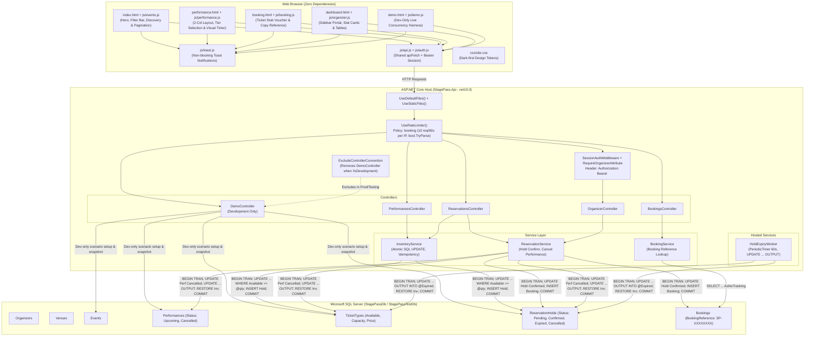

# StagePass: Complete Technical Handoff for Claude Code Review

> **Document Version**: 2.0 (Post UI-3 Security Remediation & Verification)  
> **Target Audience**: Claude (Independent Architecture & Code Reviewer)  
> **Root Directory**: `c:\Users\suhas\Desktop\StagePass`  
> **Target Framework**: .NET 10.0 (`net10.0`), C# 13, ASP.NET Core Web API, EF Core 10.0.14, Microsoft SQL Server 2025  

---

## 1. Document Purpose and Review Orientation

This document is the definitive, self-contained technical handoff for an independent, critical technical review of **StagePass**. It describes the system as implemented in the physical repository files as of October 2026, including the UI-1/UI-2/UI-3 frontend and concurrency demonstration additions and the subsequent UI-3 security remediation.

### How Claude Should Approach This Review
1. **Treat this document as a guide, not ground truth**: Validate every material statement, file path, line reference, class, and method against the source code on disk.
2. **Prioritize the frontend and user experience**: Thoroughly review the vanilla web client in [`StagePass.Api/wwwroot`](file:///c:/Users/suhas/Desktop/StagePass/StagePass.Api/wwwroot), checking semantic structure, styling tokens, toast notifications, error visibility, DOM injection resilience, and state consistency across all 7 HTML pages (`index.html`, `performance.html`, `booking.html`, `login.html`, `register.html`, `dashboard.html`, `demo.html`).
3. **Verify concurrency and transactional correctness**: Scrutinize the atomic conditional SQL `UPDATE` in [`InventoryService.cs`](file:///c:/Users/suhas/Desktop/StagePass/StagePass.Api/Services/InventoryService.cs), the idempotency fallback in [`ReservationService.cs`](file:///c:/Users/suhas/Desktop/StagePass/StagePass.Api/Services/ReservationService.cs), the background worker in [`HoldExpiryWorker.cs`](file:///c:/Users/suhas/Desktop/StagePass/StagePass.Api/BackgroundServices/HoldExpiryWorker.cs), and the database constraints in [`StagePassDbContext.cs`](file:///c:/Users/suhas/Desktop/StagePass/StagePass.Api/Data/StagePassDbContext.cs).
4. **Verify UI-3 Demo & Security Controls**: Inspect [`Program.cs`](file:///c:/Users/suhas/Desktop/StagePass/StagePass.Api/Program.cs), [`DemoController.cs`](file:///c:/Users/suhas/Desktop/StagePass/StagePass.Api/Controllers/DemoController.cs), [`RequireOrganizerAttribute.cs`](file:///c:/Users/suhas/Desktop/StagePass/StagePass.Api/Security/RequireOrganizerAttribute.cs), and [`DemoAndSecurityTests.cs`](file:///c:/Users/suhas/Desktop/StagePass/StagePass.Tests/IntegrationTests/DemoAndSecurityTests.cs).
5. **Distinguish implementation evidence from dynamic behavior**: Code-derived assertions are labeled based on source inspection. Real runtime behavior verified via the automated test suite (`StagePassTestDb`) is explicitly identified with concrete evidence.
6. **Do not modify files**: Produce an objective, ranked evaluation report first without modifying any application files or database records.

---

## 2. Project Overview and Product Scope

### 2.1 Problem Statement
In high-demand live event ticketing ("flash sales"), thousands of concurrent users attempt to purchase a limited inventory of tickets within seconds. Naive application implementations that read availability into memory, check the balance in C#, and issue a subsequent update suffer from severe race conditions under default `READ COMMITTED` transaction isolation, leading to overselling and negative inventory.

StagePass demonstrates the solution: **pushing the inventory check into an atomic, conditional SQL Server `UPDATE` statement inside an explicit database transaction**, combined with unique index constraints for idempotency and strict database `CHECK` constraints to mathematically guarantee zero overselling.

### 2.2 User Personas and Supported Workflows
- **Ticket Buyer (Customer)**:
  - Discovers upcoming performances with search, category filtering, date selection, and pagination (`index.html`).
  - Views ticket tiers, real-time availability, and pricing (`performance.html`).
  - Holds 1–10 tickets for 5 minutes (`POST /api/reservations`).
  - Observes a visual countdown timer while the server maintains the authoritative hold.
  - Confirms the hold using their email address (`POST /api/reservations/{id}/confirm`).
  - Receives a unique booking reference (`SP-XXXXXXXX`) and views confirmed booking details (`booking.html`).
- **Event Organizer (Demo Persona)**:
  - Signs in using database-backed session authentication (`login.html` / `dashboard.html`, demo account `admin@stagepass.local`).
  - Creates new events, future performances, and ticket tiers.
  - Monitors confirmed bookings and capacity/available/sold inventory breakdowns with progress bars.
  - Cancels performances and releases unconfirmed holds back to inventory.
- **Technical Evaluator / Panel Reviewer (Development-Only Live Concurrency Demo)**:
  - Opens `demo.html` (in `Development` environment) to configure a scenario (`1..10000` tickets) and fire concurrent reservation requests against `POST /api/reservations`.
  - Observes real-time allocation vs. `409 Conflict` vs. HTTP errors vs. transport failures, and verifies the database invariant (`Available + Pending + Confirmed == Capacity`).

### 2.3 Technology Stack & Versions
- **Runtime / SDK**: .NET 10 SDK (`10.0.403`), targeting `net10.0`.
- **Backend Framework**: ASP.NET Core Web API (Controller-based, minimal `Program.cs`, `System.Text.Json`).
- **ORM & Database Driver**:
  - `Microsoft.EntityFrameworkCore.SqlServer` (`10.0.14`)
  - `Microsoft.EntityFrameworkCore.Design` (`10.0.14`)
  - `Microsoft.Data.SqlClient` (`6.1.7` via EF Core transitive dependency)
  - `System.Security.Cryptography.Pkcs` (`10.0.14` directly referenced to patch transitive advisories)
- **Database Engine**: Microsoft SQL Server 2025 Developer/Evaluation edition on `localhost` (Windows Integrated Security `Trusted_Connection=True`).
- **Frontend**: Zero-dependency Vanilla HTML5, modern CSS3 (custom properties, CSS Grid, Flexbox, media queries), and Vanilla ECMAScript 2022 (Fetch API, DOM manipulation). No Node, no npm, no Vite, no TypeScript, no frameworks, no external CDNs, no external web fonts.
- **Test Framework**: xUnit (`2.9.3`), `Microsoft.NET.Test.Sdk` (`17.14.1`), `Microsoft.AspNetCore.Mvc.Testing` (`10.0.14`), `coverlet.collector` (`6.0.4`).

### 2.4 High-Level System Architecture Diagram



---

## 3. Complete Repository and File Inventory

```text
c:\Users\suhas\Desktop\StagePass\
├── .config/
│   └── dotnet-tools.json                     # Local .NET tool manifest: dotnet-ef 10.0.14
├── .editorconfig                             # Global editor formatting and naming rules
├── .gitignore                                # Build, IDE, and user-secrets artifact exclusions
├── README.md                                 # Reproducible setup, seeding, and run documentation
├── ARCHITECTURE.md                           # Formal architectural specification and invariants
├── MANAGER_DEMO.md                           # Project panel presentation script and talking points
├── CLAUDE_HANDOFF.md                         # This comprehensive technical handoff document
├── StagePass.slnx                            # Solution manifest referencing Api and Tests
├── StagePass.Api/
│   ├── StagePass.Api.csproj                  # Web API project file (net10.0, Nullable, EF Core 10)
│   ├── Program.cs                            # Pipeline setup, DI, ExcludeControllerConvention, rate limiter
│   ├── appsettings.json                      # Base config (SessionDurationDays: 7, BookingEnabled: true)
│   ├── appsettings.Development.json          # Dev config (BookingEnabled: "false", DB via User Secrets)
│   ├── appsettings.Testing.json              # Test config (rate limiting disabled)
│   ├── StagePass.Api.http                    # VS Code REST Client test requests
│   ├── BackgroundServices/
│   │   └── HoldExpiryWorker.cs               # PeriodicTimer hosted service for hold expiration
│   ├── Controllers/
│   │   ├── AuthController.cs                 # POST register/login/logout, GET me
│   │   ├── PerformancesController.cs         # GET list (supports search/category/date) & GET detail
│   │   ├── ReservationsController.cs         # POST hold, GET hold, POST confirm
│   │   ├── BookingsController.cs             # GET booking by reference
│   │   ├── OrganizerController.cs            # GET venues, POST event/perf/tier, GET bookings, PATCH cancel
│   │   └── DemoController.cs                 # Dev-only POST setup-scenario & GET snapshot/{ticketTypeId}
│   ├── Data/
│   │   ├── StagePassDbContext.cs             # EF Core DbContext, constraints, fluent mapping
│   │   ├── DbInitializer.cs                  # Idempotent dev seeder (2 venues, 1 org, 2 events, 3 perfs, 6 tiers, demo user)
│   │   └── Migrations/
│   │       ├── 20261027104645_InitialCreate.cs
│   │       ├── 20261027104645_InitialCreate.Designer.cs
│   │       ├── 20261101122026_AddAuthentication.cs
│   │       └── StagePassDbContextModelSnapshot.cs
│   ├── DTOs/
│   │   ├── Auth/                             # RegisterRequest, LoginRequest, AuthResponse
│   │   ├── Bookings/BookingDetailsDto.cs
│   │   ├── Organizers/
│   │   │   ├── CreateEventRequest.cs
│   │   │   ├── CreatePerformanceRequest.cs
│   │   │   ├── CreateTicketTypeRequest.cs
│   │   │   └── OrganizerBookingDto.cs
│   │   ├── Performances/
│   │   │   ├── PerformanceListItemDto.cs
│   │   │   ├── PerformanceDetailsDto.cs
│   │   │   └── TicketTypeDto.cs
│   │   └── Reservations/
│   │       ├── CreateReservationRequest.cs
│   │       ├── ConfirmReservationRequest.cs
│   │       └── ReservationResponse.cs
│   ├── Entities/
│   │   ├── Venue.cs
│   │   ├── Organizer.cs
│   │   ├── Event.cs
│   │   ├── Performance.cs
│   │   ├── TicketType.cs
│   │   ├── ReservationHold.cs
│   │   ├── Booking.cs
│   │   ├── AppUser.cs
│   │   └── AppSession.cs
│   ├── Enums/
│   │   ├── PerformanceStatus.cs              # Upcoming, Cancelled
│   │   └── ReservationStatus.cs              # Pending, Confirmed, Expired, Cancelled
│   ├── Security/
│   │   ├── PasswordHasher.cs                 # PBKDF2-SHA256 (100k iterations, 32-byte salt)
│   │   ├── SessionAuthMiddleware.cs          # Resolves Authorization: Bearer <token> from AppSessions
│   │   ├── RequireAuthAttribute.cs           # Enforces authenticated session (401 AuthRequired)
│   │   └── RequireOrganizerAttribute.cs      # Enforces organizer role (401 AuthRequired / 403 OrganizerRequired)
│   ├── Services/
│   │   ├── ServiceResult.cs
│   │   ├── ErrorCodes.cs
│   │   ├── InventoryService.cs               # Atomic allocation & idempotency resolution
│   │   ├── ReservationService.cs             # Confirmation, hold status, performance cancellation
│   │   ├── BookingService.cs                 # Confirmed booking reference projection
│   │   └── EmailService.cs                   # Transactional Gmail SMTP confirmation emails with failure isolation
│   └── wwwroot/                              # Static client files
│       ├── index.html                        # Discovery page (Hero, carousels, category pills, search)
│       ├── performance.html                  # Detail page (2-column layout, sticky booking panel, SVG ring timer)
│       ├── booking.html                      # Confirmation page (Perforated ticket stub, copyable ref, email notice)
│       ├── login.html                        # Customer and organizer sign-in page
│       ├── register.html                     # Account registration page
│       ├── dashboard.html                    # Organizer portal (Sidebar nav, stat cards, progress bars, venue selector)
│       ├── demo.html                         # Concurrency demo page (Config, request storm visualizer, progress track, result cards)
│       ├── css/site.css                      # Unified dark-stage design system, responsive, print & toast styles
│       └── js/
│           ├── api.js                        # Unified fetch wrapper with error parsing
│           ├── auth.js                       # Session storage & Bearer token injection wrapper
│           ├── toast.js                      # Shared showToast(message, type, duration) utility
│           ├── nav.js                        # Shared navigation bar & user dropdown renderer
│           ├── events.js                     # Catalog loading, debounce search, category filtering
│           ├── performance.js                # Detail loading, hold creation, sessionStorage recovery, confirmation
│           ├── booking.js                    # Booking reference lookup and presentation
│           ├── organizer.js                  # Organizer dashboard interactions & venue loading
│           ├── storm.js                      # Real-time request storm canvas animation visualizer
│           └── demo.js                       # Concurrency harness with controlled pool & RPS calculation
└── StagePass.Tests/
    ├── StagePass.Tests.csproj                # xUnit test project referencing StagePass.Api
    ├── TestWebApplicationFactory.cs          # Test host pinned to StagePassTestDb with demo cleanup
    ├── UnitTests/
    │   ├── ReservationInputTests.cs          # Pure Validator.TryValidateObject tests (6 passed)
    │   └── DatabaseSeedVerificationTests.cs  # Idempotent seed count verification (1 passed)
    └── IntegrationTests/
        ├── ReservationLifecycleTests.cs      # Full HTTP hold/confirm/expiry/invariant tests (11 passed)
        ├── IdempotencyTests.cs               # Sequential, conflict, and 50-concurrent same-key (3 passed)
        ├── ReservationConcurrencyTests.cs    # 500-request oversell & race condition tests (3 passed)
        ├── ApiSmokeTests.cs                  # Controller endpoint status code verification (14 passed)
        ├── AuthTests.cs                      # Registration, PBKDF2 hashing, login, logout, organizer RBAC & venues (20 passed)
        ├── DemoAndSecurityTests.cs           # Demo env/validation/DB effects, rate limit & organizer auth tests (28 passed)
        └── EmailTests.cs                     # Disabled email 200 OK and non-email customer skip tests (2 passed)
```

---

## 4. CRITICAL SECTION: Complete Website and Frontend Review

The frontend is served directly by ASP.NET Core (`app.UseDefaultFiles()` + `app.UseStaticFiles()` in [`Program.cs`](file:///c:/Users/suhas/Desktop/StagePass/StagePass.Api/Program.cs#L86-L87)) from [`StagePass.Api/wwwroot`](file:///c:/Users/suhas/Desktop/StagePass/StagePass.Api/wwwroot).

### 4.1 Website-Wide Design System ([`css/site.css`](file:///c:/Users/suhas/Desktop/StagePass/StagePass.Api/wwwroot/css/site.css))
- **Color Tokens**: Dark-first palette (`--bg-base: #09090b`, `--bg-surface: #18181b`, `--bg-elevated: #27272a`, `--brand: #7c3aed`, `--brand-hover: #6d28d9`) with automatic light-mode adaptation via `@media (prefers-color-scheme: light)`.
- **Navigation Header**: Sticky glassmorphism header (`.site-header`) with brand link (`StagePass`) and navigation links (`All Events`, `🔬 Live Demo`, `Organizer`).
- **Toast Notification System ([`js/toast.js`](file:///c:/Users/suhas/Desktop/StagePass/StagePass.Api/wwwroot/js/toast.js))**: Global `window.showToast(message, type = 'info', duration = 4000)` renders slide-in notifications inside `#toast-container` using `el.textContent = message` (XSS-safe).

### 4.2 Page-by-Page Breakdown

#### 4.2.1 `index.html` + `js/events.js` — Event Catalog & Discovery
- **Structure**: Hero banner (`.hero`), filter bar (`.filter-bar` with `#search`, `#category`, `#date`, `#search-btn`), `#error-display`, `#events-grid` (initialized with 6 `.skeleton-card` placeholders), and `.pagination` (`#prev-btn`, `#page-label`, `#next-btn`).
- **Behavior**: Calls `GET /api/performances` via `apiFetch`, supports debounced search (backed by server-side `e.Title.Contains(search)` in [`PerformancesController.cs`](file:///c:/Users/suhas/Desktop/StagePass/StagePass.Api/Controllers/PerformancesController.cs#L31-L35)), category filtering, and date filtering.

#### 4.2.2 `performance.html` + `js/performance.js` — Performance Detail & Hold Flow
- **Structure**: Breadcrumb link back to `index.html`, `#error-display`, and `.perf-layout` (2-column grid on desktop: left column with `#performance-detail` and `#ticket-types` radio tier cards; right sticky `.reservation-card` with `#reservation-form` and `#hold-status`).
- **Behavior**:
  - Generates a per-attempt `idempotencyKey` via `crypto.randomUUID()`.
  - Submits `POST /api/reservations` and transitions to `#hold-status` with a tabular `MM:SS` countdown (`#countdown-display`), firing `showToast` notifications on hold creation, idempotent retry, expiry, and confirmation.
  - Confirms via `POST /api/reservations/{holdId}/confirm` and redirects to `booking.html?ref={bookingReference}`.

#### 4.2.3 `booking.html` + `js/booking.js` — Booking Confirmation Voucher
- **Structure**: Perforated ticket-stub layout (`.booking-ticket`, `.ticket-top`, `.ticket-divider`, `.ticket-body`, `.ticket-ref-box`, `.ticket-meta-grid`) with a click-to-copy booking reference box and toast feedback.
- **Behavior**: Reads `ref` from query string and calls `GET /api/bookings/{ref}` via `apiFetch`.

#### 4.2.4 `dashboard.html` + `js/organizer.js` — Organizer Dashboard
- **Structure**:
  - `#auth-gate`: Shown when the visitor is not signed in with an organizer session (`isOrganizer === true`), offering direct links to `login.html?returnTo=dashboard.html` and `register.html?organizer=true`.
  - `#dash-layout`: Sidebar layout (`.dash-layout`) with 4 single-page panels (`#page-overview`, `#page-events`, `#page-create`, `#page-bookings`), stat cards (`#stat-bookings`, `#stat-sold`, `#stat-holds`, `#stat-avail`), `#inv-results` capacity progress bars, live venue selector (`#ev-venue` populated from `GET /api/organizer/venues`), and `#bookings-table-wrap`.
- **Security Note**: `js/auth.js` attaches `Authorization: Bearer <token>` from `sp_session` on all `/api/organizer/*` calls, and the server enforces `[RequireOrganizer]` (`401 AuthRequired` when unauthenticated, `403 OrganizerRequired` when `IsOrganizer` is `false`).

#### 4.2.5 `demo.html` + `js/demo.js` — Live Concurrency Demonstration Page
- **Purpose**: Interactive concurrency test harness for project panel demonstrations in the `Development` environment.
- **Structure**:
  - Configuration controls (`#cfg-tickets` 1..10000, `#cfg-requests` 1..50000, `#cfg-pool` 10..500, `#demo-run-btn`).
  - Real-time progress bar (`.request-track` with success, conflict, ratelimit, and error segments).
  - 6 Result Cards:
    - `#r-total`: Total Requests
    - `#r-success`: ✓ Tickets Allocated (`200`/`201`)
    - `#r-conflict`: ⊘ Sold Out (`409`)
    - `#r-errors`: ✗ Server Errors (non-`200`/`201`/`409`/`429` status codes)
    - `#r-ratelimit`: ⚡ Rate Limited (`429`)
    - `#r-done`: ✓ Completed
  - Throughput counter (`#r-rps`).
  - Database Invariant Verification box (`#invariant-panel`, `#invariant-formula`, `#invariant-result`).
- **Controlled Concurrency Pool (`js/demo.js`)**:
  A rolling pool (`runPool`) executes concurrent requests up to `poolSize` in flight at a time, preventing browser socket exhaustion at scale while updating live counters and progress bars in real time.

---

## 5. Backend Architecture and UI-3 Security Remediations

### 5.1 Environment-Gated `DemoController` Registration ([`Program.cs`](file:///c:/Users/suhas/Desktop/StagePass/StagePass.Api/Program.cs#L18-L26) & [`DemoController.cs`](file:///c:/Users/suhas/Desktop/StagePass/StagePass.Api/Controllers/DemoController.cs))
- **Route Exclusion Outside Development**:
  In `Program.cs`, an `IApplicationModelConvention` (`ExcludeControllerConvention(typeof(DemoController))`) is registered via `builder.Services.AddOptions<MvcOptions>().Configure<IHostEnvironment>(...)` whenever `!env.IsDevelopment()`. When `app.MapControllers()` builds the endpoint table in `Production` or `Testing`, `DemoController` is stripped from `ApplicationModel.Controllers`, so `/api/demo/*` routes do not exist in the routing table and return `404 Not Found`.
- **Defense-in-Depth**:
  `DemoController` also injects `IHostEnvironment` and checks `if (!_env.IsDevelopment()) return NotFound();` at the start of both `SetupScenario` and `GetSnapshot`.
- **Input Validation (`DemoController.cs`)**:
  - `tickets`: Bounded to `1..10000` (`MinTickets = 1`, `MaxTickets = 10000`). Out-of-range values return `400 BadRequest` with `{ error = "InvalidTicketCount" }`.
  - `scenarioName`: Inspects `Request.Query["scenarioName"]` when provided (defaulting to `"Demo Scenario"` only when the query parameter is omitted). Rejects empty, whitespace-only, or `> 100`-character values with `400 BadRequest` (`{ error = "InvalidScenarioName" }`).
  - `ticketTypeId`: Rejects `ticketTypeId <= 0` in `GetSnapshot` with `400 BadRequest` (`{ error = "InvalidTicketTypeId" }`).

### 5.2 Database-Backed Session Authentication ([`SessionAuthMiddleware.cs`](file:///c:/Users/suhas/Desktop/StagePass/StagePass.Api/Security/SessionAuthMiddleware.cs) & [`RequireOrganizerAttribute.cs`](file:///c:/Users/suhas/Desktop/StagePass/StagePass.Api/Security/RequireOrganizerAttribute.cs))
- **PBKDF2-SHA256 Password Hashing**: `PasswordHasher` hashes passwords with a 32-byte CSPRNG salt and 100,000 iterations of PBKDF2-SHA256 (`Rfc2898DeriveBytes.Pbkdf2`), comparing hashes in constant time via `CryptographicOperations.FixedTimeEquals`.
- **Session Resolution & Role Enforcement**: `SessionAuthMiddleware` resolves `Authorization: Bearer <token>` against `AppSessions` (`ExpiresAt > DateTime.UtcNow`) and populates `HttpContext.Items["CurrentUser"]`. `[RequireOrganizer]` rejects unauthenticated callers with `401 AuthRequired` and non-organizer users with `403 OrganizerRequired`.
- **Seeded Demo Organizer**: `DbInitializer.SeedAsync` seeds `admin@stagepass.local` (`StagePass2026!`, `IsOrganizer = true`) and links `POST /api/organizer/events` to the caller's `Organizers` record by email.

### 5.3 Rate Limiting Boolean Configuration Parsing ([`Program.cs`](file:///c:/Users/suhas/Desktop/StagePass/StagePass.Api/Program.cs#L44-L66))
- **Bug Fixed**: Previously, `Program.cs` compared `builder.Configuration["RateLimiting:BookingEnabled"] == "true"` using case-sensitive string equality at startup. Because .NET's JSON configuration provider normalizes JSON boolean `true` to `"True"`, rate limiting was inadvertently disabled even when `BookingEnabled` was `true`.
- **Remediation**: Inside the `"booking"` rate limiter policy partition callback, `IConfiguration` is resolved from `httpContext.RequestServices` and parsed via:
  ```csharp
  var bookingRateLimitEnabled =
      bool.TryParse(config["RateLimiting:BookingEnabled"], out var enabled) && enabled;
  ```
  This properly parses `"True"`, `"true"`, `"False"`, and `"false"`, and respects per-host test configuration overrides.

### 5.4 Demo Architecture Limitations (Important for Reviewers)
1. **Interaction Between `demo.html` and Booking Rate Limiting**:
   Now that `RateLimiting:BookingEnabled: true` in `appsettings.json` is properly parsed by `bool.TryParse`, `POST /api/reservations` enforces the configured limit of **10 requests per 60 seconds per client IP** by default. Consequently:
   - In `StagePass.Tests` (`Testing` environment), `appsettings.Testing.json` sets `"BookingEnabled": false` so the 500-request concurrency test (`ReservationConcurrencyTests`) tests SQL Server concurrency without IP rate-limit throttling (while `DemoAndSecurityTests` explicitly tests `"BookingEnabled": "True"`/`"true"` vs `"False"`/`"false"`).
   - When running `demo.html` interactively in `Development` with `requests > 10` from a single browser (`localhost`), requests beyond the 10th within a 60-second window will receive `429 Too Many Requests` (counted under `✗ HTTP Errors` on `demo.html`) unless `RateLimiting:BookingEnabled` is set to `false` in `appsettings.Development.json` or User Secrets during the concurrency demo.
2. **Demo Entity Persistence in Development Database**:
   Each call to `POST /api/demo/setup-scenario` in `Development` reuses `"Demo Venue"` and `"demo@stagepass.local"` (`Demo Organizer`), and inserts a new `Event` (`Category = "Demo"`), `Performance` (`StartDateTime = UtcNow.AddDays(1)`), and `TicketType` (`Name = "Demo Ticket"`). Because `GET /api/performances` lists all `Upcoming` performances, demo scenarios created against a local development database will appear in the public catalog unless filtered or cleaned up.

---

## 6. Complete API Endpoint Inventory

| Method | Route | Controller Action | Environment / Auth / Limiter | Request DTO / Params | Response Shape | Status Codes |
| :--- | :--- | :--- | :--- | :--- | :--- | :--- |
| `GET` | `/api/performances` | `PerformancesController.GetPerformances` | All / Public | Query: `category`, `date`, `search`, `page`, `pageSize` | `List<PerformanceListItemDto>` | `200 OK`, `400 Bad Request` |
| `GET` | `/api/performances/{id}` | `PerformancesController.GetPerformance` | All / Public | Route: `id` | `PerformanceDetailsDto` | `200 OK`, `404 Not Found` |
| `POST` | `/api/reservations` | `ReservationsController.CreateReservation` | All / RateLimit: `booking` (10/60s per IP) | `CreateReservationRequest` | `ReservationResponse` | `201 Created`, `200 OK`, `400`, `409 Conflict`, `429 Too Many` |
| `GET` | `/api/reservations/{holdId}` | `ReservationsController.GetReservation` | All / Public | Route: `holdId` | `ReservationResponse` | `200 OK`, `404 Not Found` |
| `POST` | `/api/reservations/{holdId}/confirm` | `ReservationsController.ConfirmReservation` | All / Public | `ConfirmReservationRequest` | `{ bookingReference }` | `200 OK`, `404 Not Found`, `409 Conflict` |
| `GET` | `/api/bookings/{reference}` | `BookingsController.GetBooking` | All / Public | Route: `reference` | `BookingDetailsDto` | `200 OK`, `404 Not Found` |
| `POST` | `/api/auth/register` | `AuthController.Register` | All / Public | `RegisterRequest` | `AuthResponse` | `200 OK`, `400`, `409 Conflict` |
| `POST` | `/api/auth/login` | `AuthController.Login` | All / Public | `LoginRequest` | `AuthResponse` | `200 OK`, `400`, `401 Unauthorized` |
| `POST` | `/api/auth/logout` | `AuthController.Logout` | All / `[RequireAuth]` | Bearer token | `{ message }` | `200 OK`, `401 Unauthorized` |
| `GET` | `/api/auth/me` | `AuthController.Me` | All / `[RequireAuth]` | Bearer token | `{ userId, name, email, isOrganizer }` | `200 OK`, `401 Unauthorized` |
| `GET` | `/api/organizer/venues` | `OrganizerController.GetVenues` | All / `[RequireOrganizer]` | Bearer token | `List<{ venueId, name, city }>` | `200 OK`, `401`, `403` |
| `POST` | `/api/organizer/events` | `OrganizerController.CreateEvent` | All / `[RequireOrganizer]` | `CreateEventRequest` | `{ eventId }` | `201 Created`, `400`, `401`, `403` |
| `POST` | `/api/organizer/performances` | `OrganizerController.CreatePerformance` | All / `[RequireOrganizer]` | `CreatePerformanceRequest` | `{ performanceId }` | `201 Created`, `400`, `401`, `403`, `404` |
| `POST` | `/api/organizer/performances/{id}/tickettypes` | `OrganizerController.CreateTicketType` | All / `[RequireOrganizer]` | `CreateTicketTypeRequest` | `{ ticketTypeId }` | `201 Created`, `400`, `401`, `403`, `404`, `409` |
| `GET` | `/api/organizer/performances/{id}/bookings` | `OrganizerController.GetPerformanceBookings` | All / `[RequireOrganizer]` | Route: `id` | `{ bookings, summary }` | `200 OK`, `401`, `403`, `404` |
| `PATCH`| `/api/organizer/performances/{id}/cancel` | `OrganizerController.CancelPerformance` | All / `[RequireOrganizer]` | Route: `id` | `{ status: "Cancelled" }` | `200 OK`, `401`, `403`, `404`, `409` |
| `POST` | `/api/demo/setup-scenario` | `DemoController.SetupScenario` | **Development Only** | Query: `tickets` (1..10000), `scenarioName` (1..100 chars) | `{ ticketTypeId, performanceId, capacity, scenarioName }` | `200 OK`, `400 Bad Request`, `404 Not Found` (non-Dev) |
| `GET` | `/api/demo/snapshot/{ticketTypeId}` | `DemoController.GetSnapshot` | **Development Only** | Route: `ticketTypeId` (> 0) | `{ capacity, available, pendingHeld, confirmed, invariantHolds, formula }` | `200 OK`, `400 Bad Request`, `404 Not Found` |

---

## 7. Security Review and Vulnerability Assessment

| # | Severity | Category | Description | Status |
|---|:---:|---|---|:---:|
| 1 | **Medium** | Auth & Tenancy | `AppUser` links to `Organizers` by email on event creation, while performance/booking actions check `[RequireOrganizer]` without per-event ownership enforcement. | Confirmed (Documented MVP scope) |
| 2 | **Medium** | Rate Limiting | Rate limiter keys on `RemoteIpAddress` without `ForwardedHeadersMiddleware`. | Confirmed (Deployment Risk behind reverse proxy) |
| 3 | **Low** | Demo Surface | `/api/demo/*` endpoints excluded from route registration outside `Development` via `ExcludeControllerConvention` + controller guard + input bounds (`1..10000` tickets, `1..100` char name). | Verified Mitigated |
| 4 | **Low** | Rate Limit Config | `RateLimiting:BookingEnabled` parsed via `bool.TryParse` and verified with explicit `"True"`/`"true"`/`"False"`/`"false"` integration tests. | Verified Mitigated |
| 5 | **Low** | Password Timing | `PasswordHasher` uses `CryptographicOperations.FixedTimeEquals` on 32-byte PBKDF2-SHA256 digests. | Verified Mitigated |
| 6 | **Low** | Injection & XSS | Parameterized SQL placeholders (`{0}`) and DOM construction via `textContent` / `createElement`. | Verified Mitigated |

---

## 8. Test Inventory and Verification Evidence

All **88 automated test executions** pass against `StagePassTestDb` with **0 failures, 0 skipped, and 0 warnings**.
`TestWebApplicationFactory` unconditionally pins `ConnectionStrings:DefaultConnection` to `StagePassTestDb` and verifies `context.Database.GetDbConnection().Database == "StagePassTestDb"` before executing any reset or migration logic, ensuring `StagePassDb` is never touched by automated tests.

### Complete Test Suite Summary

| Test Class | Test Count | Category | What It Proves |
| :--- | :---: | :--- | :--- |
| `ReservationInputTests` | 6 | Unit | DataAnnotations & `IValidatableObject` reject invalid quantities (`0`, `-1`, `11`), empty customer identifier, and `Guid.Empty` idempotency key. |
| `DatabaseSeedVerificationTests` | 1 | Integration | `DbInitializer.SeedAsync` idempotently seeds 2 venues, 1 organizer, 2 events, 3 performances, and 6 ticket types. |
| `ReservationLifecycleTests` | 11 | Integration | Full hold creation (`201`), insufficient inventory (`409`), confirmation (`200`), double confirm (`409`), expired hold confirm (`409`), wrong owner (`409`), booking lookup (`200`/`404`), worker expiry restoration, and mixed-operation invariant preservation. |
| `IdempotencyTests` | 3 | Integration | Sequential retry (`200`), parameter mismatch (`409 IdempotencyKeyReused`), and 50 concurrent identical-key requests creating exactly 1 hold. |
| `ReservationConcurrencyTests` | 3 | Concurrency (`RequiresSqlServer`) | 500 concurrent requests for 100 tickets -> 100 `201 Created`, 400 `409 Conflict`, 0 errors; confirm-vs-expiry race and cancel-vs-expiry race preserve inventory invariant. |
| `ApiSmokeTests` | 14 | Smoke / Integration | End-to-end HTTP contract verification across `PerformancesController`, `ReservationsController`, `BookingsController`, and `OrganizerController`. |
| `AuthTests` | 20 | Authentication & RBAC | Registration, PBKDF2-SHA256 password hashing, duplicate email (`409`), login (`200`/`401`), session isolation on logout, `GET /api/auth/me`, `[RequireOrganizer]` (`401`/`403`), and `GET /api/organizer/venues`. |
| `DemoAndSecurityTests` | 28 | Security & Demo Integration | Verifies `/api/demo/*` returns `404` in `Testing` and `Production`; validates `tickets`, `scenarioName`, and `ticketTypeId`; verifies valid scenario creation and snapshot invariant in `Development`; verifies `RateLimiting:BookingEnabled` boolean parsing; verifies `[RequireOrganizer]` rejects missing/invalid/expired/customer tokens across all organizer endpoints. |
| `EmailTests` | 2 | Email Integration | Verifies booking confirmation succeeds with `200 OK` and valid `SP-` reference when email is disabled; verifies non-email customer identifiers skip email delivery while preserving confirmation. |
| **Total** | **88** | **All Suites** | **88 Passed, 0 Failed, 0 Skipped** |
